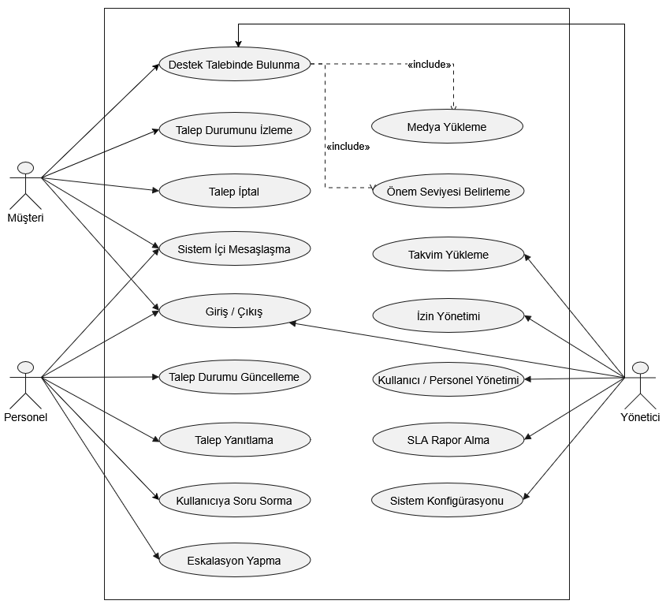

# Destek Talebi Sistemi ve SLA Yönetimi - Yazılım Gereksinimi Belgesi (SRS)

## 1. Amaç
Bu projenin temel amacı; işletmelerin müşteri destek süreçlerini optimize eden, dinamik SLA (Hizmet Seviyesi Anlaşması) hesaplamaları ve akıllı iş yükü dağıtımı sunan yönetilebilir bir sistem geliştirmektir. İşletmeler bu sistemi kendi sunucularına kurarak ve kendi alan adlarını bağlayarak müşterilerine kendi kurumsal siteleri üzerinden hizmet verebileceklerdir. Sistem, müşteri taleplerini personelin aktif mesai saatlerine ve özel çalışma takvimine göre değerlendirerek hedef çözüm sürelerini otomatik belirler. Bu esnek yapı sayesinde işletmeler, mevcut insan kaynaklarını en yüksek verimle kullanabilir.

## 2. Çekirdek Problem ve Proje Kapsamı
Bu projenin çözdüğü çekirdek mühendislik problemi, dinamik takvim verilerine ve personel izin/iş yükü durumlarına duyarlı SLA hesaplama ve eskalasyon algoritmasıdır.
* Sistem; çalışma saatlerini ve tatil günlerini JSON formatında dışarıdan alır. Yöneticiler takvim üzerinde en erken 5 gün sonrası için değişiklik yapabilir.
* Algoritma, talep çözüm sürecindeki spesifik durum akışını (Talep Bekleniyor → Talep Alındı → Talep İnceleniyor → Talep Çözüldü) takip eder.
* Akıllı Eskalasyon: Personelin çözüm için maksimum 3 deneme hakkı vardır. 3 kez reddedilen çözüm sonrası talep otomatik eskalasyona uğrar. Ayrıca, yönetici bir personele izin verdiğinde, personelin elindeki "henüz cevaplanmamış" bir talebin SLA bitiş tarihi bu izin gününe denk geliyorsa, sistem talebi beklemeden otomatik eskalasyon yapar.

## 3. Kapsam Dışı
Aşağıdaki özellikler **kapsam dışı** bırakılmıştır:
* E-posta veya SMS ile bildirim gönderimi.
* Canlı sohbet entegrasyonu (Müşteri ve personel, SLA süresi boyunca sadece talep sayfası üzerinden anlık veya asenkron mesajlaşarak iletişim kurar).
* Gerçek ödeme sistemi veya faturalandırma.
* Biletleri PDF olarak indirme işlemi.

## 4. Varsayımlar ve Bağımlılıklar
* **Sunucu Saat Dilimi:** Sistemin kurulu olduğu sunucunun saat dilimi (Timezone) ayarlarının, işletmenin bulunduğu fiziksel konuma göre doğru yapılandırıldığı varsayılmıştır.
* **Geçerli Veri Formatı:** Yönetici tarafından çalışma programı olarak sisteme yüklenen JSON dosyasının, sistemin beklediği veri şemasına (schema) uygun, eksiksiz ve UTF-8 formatında olduğu varsayılmıştır.
* **Donanım/Ağ Bağımlılığı:** Sistemin sürekli olarak aktif bir MySQL/MariaDB veritabanı sunucusuna bağlı olduğu varsayılmıştır.

## 5. Kısıtlamalar (Constraints)
* **Teknik Kısıtlama (Çatı Bağımsızlığı):** Proje, Laravel veya Symfony gibi harici hazır framework'ler kullanılmadan, PHP, PDO ve Nesne Yönelimli Programlama prensipleriyle (PSR-4 standartlarında) geliştirilmek zorundadır.
* **Mimari Kısıtlama:** Sistem kesinlikle katmanlı mimariyle (Controller, Service, Repository, Model) inşa edilmeli; durum geçişleri State deseniyle, eskalasyon uyarıları ise Observer deseniyle yönetilmelidir.
* **Veritabanı Kısıtlaması:** Veritabanı tasarımı zorunlu olarak en az 3NF (Üçüncü Normal Form) kurallarına uygun şekilde normalize edilmelidir.
* **Dosya Kısıtlaması:** Müşteriler tarafından yüklenecek olan sorun gösterge ekleri güvenlik sebebiyle görsel olarak sadece JPG ve PDF video olarak ise MP4 ve WebM formatlarıyla kısıtlanmış olup, dosya başına maksimum yükleme boyutu yönetici tarafından belirlenecektir.

## 6. Tanımlar ve Kısaltmalar
* **SLA (Service Level Agreement):** Hizmet Seviyesi Anlaşması. Müşterinin açtığı bir destek talebinin, işletmenin mesai saatlerine göre maksimum kaç saat/gün içinde çözülmesi gerektiğini belirleyen taahhüt süresi.
* **Eskalasyon:** SLA süresi dolan, izin günü çakışması yaşanan veya personelin 3 çözüm hakkını tükettiği durumlarda, biletin otomatik veya manuel olarak bir üst yetkiliye devredilmesi işlemi.
* **Kanban Panosu:** Personelin üzerine aldığı destek taleplerini durumlarına göre sütunlar halinde gördüğü ve sürükle-bırak yöntemiyle güncellediği asenkron (AJAX) çalışma arayüzü.
* **Görev Havuzu:** Sisteme yeni düşmüş, statüsü "Talep Bekleniyor" olan ve henüz hiçbir destek personeli tarafından kabul edilmemiş biletlerin beklediği genel kuyruk.
* **JSON (JavaScript Object Notation):** Yöneticilerin, işletmeye özel çalışma günlerini, saatlerini ve tatillerini sisteme aktarmak için kullanacakları hafif, metin tabanlı veri değişim formatı.
* **Core PHP:** Herhangi bir dış kütüphane veya web çatısı kullanılmadan yazılan saf PHP kod yapısı.

## 7. Use Case

## 8. Kullanıcı Hikayeleri

**Müşteri Hikayeleri:**

*   **US-01 – Müşteri Kaydı:** Müşteri olarak, ad-soyad, benzersiz kullanıcı bilgisi ve parola ile sisteme kayıt olabilmek istiyorum; böylece e-posta veya SMS kullanmadan üyelik oluşturabilirim.

*   **US-02 – Sisteme Giriş:** Müşteri olarak, kullanıcı bilgilerim ve parolam ile sisteme giriş yapabilmek istiyorum; böylece kendi destek taleplerime erişebilirim.

*   **US-03 – Destek Talebi Oluşturma:** Müşteri olarak, kategori, konu, açıklama ve gerekli form alanlarını doldurarak destek talebi oluşturabilmek istiyorum; böylece yaşadığım sorunu ilgili birime iletebilirim.

*   **US-04 – Talebe Dosya Ekleme:** Müşteri olarak, destek talebime izin verilen tür ve boyuttaki dosyaları ekleyebilmek istiyorum; böylece sorunumu görsel veya video ile açıklayabilirim.

*   **US-05 – Talep Listesini Görüntüleme:** Müşteri olarak, oluşturduğum destek taleplerini durumlarına göre listeleyebilmek, filtreleyebilmek ve arayabilmek istiyorum; böylece taleplerimin güncel durumunu takip edebilirim.

*   **US-06 – Talep Ayrıntılarını Görüntüleme:** Müşteri olarak, bir destek talebinin açıklamasını, işlem geçmişini, yanıtlarını ve eklerini görüntüleyebilmek istiyorum; böylece talebimle ilgili tüm bilgilere ulaşabilirim.

*   **US-07 – Talebe Yanıt Verme:** Müşteri olarak, destek talebime personel tarafından verilen yanıtları okuyup yeni yanıtlar yazabilmek istiyorum; böylece sorun çözülene kadar iletişim kurabilirim.

*   **US-08 – Aciliyet Bildirme:** Müşteri olarak, destek talebi oluştururken sorunumun aciliyetini belirtebilmek istiyorum; böylece destek ekibi talebin önemini değerlendirebilir.

*   **US-09 – Talep İptal Etme:** Müşteri olarak, henüz personel tarafından işleme alınmamış destek talebimi iptal edebilmek istiyorum; böylece yanlışlıkla oluşturduğum veya artık ihtiyaç duymadığım taleplerin işleme alınmasını önleyebilirim.

*   **US-10 – Çözümü Değerlendirme:** Müşteri olarak, çözüldüğü bildirilen destek talebimin işe yarayıp yaramadığını belirtebilmek istiyorum; böylece çözümün yeterliliğini destek ekibine bildirebilirim.

*   **US-11 – Çözülmeyen Talebe Geri Bildirim Verme:** Müşteri olarak, sunulan çözümün sorunumu gidermediğini belirtebilmek istiyorum; böylece talebim yeniden işleme alınabilir.

*   **US-12 – Parola Sıfırlama:** Müşteri olarak, güvenlik soruma doğru cevap vererek parolamı sıfırlayabilmek istiyorum; böylece e-posta veya SMS erişimine ihtiyaç duymadan hesabıma yeniden erişebilirim.

*   **US-13 – Bildirimleri Görüntüleme:** Müşteri olarak, destek taleplerimle ilgili yeni yanıt, durum değişikliği ve çözüm bildirimlerini sistem içerisinde görebilmek istiyorum; böylece gelişmelerden haberdar olabilirim.

*   **US-14 – Talep Geçmişini Görüntüleme:** Müşteri olarak, geçmişte oluşturduğum ve tamamlanan destek taleplerini görüntüleyebilmek istiyorum; böylece önceki sorunlarımın çözümlerine tekrar ulaşabilirim.

*   **US-15 – Atanan Talepleri Kanban Panosunda Görüntüleme:** Personel olarak, üzerime atanmış destek taleplerini durumlarına göre Kanban panosunda görebilmek istiyorum; böylece iş yükümü kolayca takip edebilirim.

*   **US-16 – Talep Durumunu Güncelleme:** Personel olarak, yetkim dahilindeki destek taleplerinin durumunu Kanban panosunda sürükle-bırak yöntemiyle değiştirebilmek istiyorum; böylece iş akışını hızlıca güncelleyebilirim.

*   **US-17 – Talebe Yanıt Yazma:** Personel olarak, destek talebine metin ve izin verilen ek dosyalarla yanıt verebilmek istiyorum; böylece müşteriye çözüm veya bilgilendirme sunabilirim.

*   **US-18 – Müşteriden Bilgi İsteme:** Personel olarak, sorunu çözmek için müşteriye soru yöneltebilmek istiyorum; böylece eksik bilgileri tamamlayabilirim.

*   **US-19 – SLA Süresini Görüntüleme:** Personel olarak, üzerime atanmış taleplerin kalan SLA sürelerini dakika ve saat cinsinden görebilmek istiyorum; böylece zamanında işlem yapabilirim.

*   **US-20 – SLA Uyarılarını Görüntüleme:** Personel olarak, SLA süresi yaklaşan veya ihlal edilen talepleri görsel uyarılarla ayırt edebilmek istiyorum; böylece önceliklerimi doğru belirleyebilirim.

*   **US-21 – Talep Ayrıntılarını ve Eklerini Görüntüleme:** Personel olarak, üzerime atanmış talebin tüm ayrıntılarına ve yetkim dahilindeki ek dosyalarına erişebilmek istiyorum; böylece sorunu doğru değerlendirebilirim.

*   **US-22 – İşlem Geçmişini Görüntüleme:** Personel olarak, bir talep üzerinde daha önce gerçekleştirilen işlemleri ve yazışmaları görebilmek istiyorum; böylece önceki çalışmaları takip edebilirim.

*   **US-23 – Talep İçin İç Not Ekleme:** Personel olarak, müşteriye gösterilmeyen iç notlar ekleyebilmek istiyorum; böylece ekip içi bilgi paylaşımını sağlayabilirim.

*   **US-24 – Personel Performans Puanını Görüntüleme:** Personel olarak, çözdüğüm taleplerden kazandığım puanları ve toplam puanımı görebilmek istiyorum; böylece performansımı takip edebilirim.

*   **US-25 – Eskalasyon Talep Etme:** Personel olarak, kendi yetkinliğimi veya çözüm imkanlarımı aşan bir talep için üst seviyeden destek isteyebilmek istiyorum; böylece talebin çözüm sürecinin devam etmesini sağlayabilirim.

*   **US-26 – Personel Yönetimi:** Yönetici olarak, sisteme yeni personel ekleyebilmek, personel bilgilerini düzenleyebilmek ve hesapları etkinleştirip devre dışı bırakabilmek istiyorum; böylece personel erişimlerini yönetebilirim.

*   **US-27 – Personel Yetkilendirme:** Yönetici olarak, personelin rolünü, yetkilerini ve erişebileceği işlem alanlarını belirleyebilmek istiyorum; böylece sistemdeki işlemleri kontrol altında tutabilirim.

*   **US-28 – Kategori Yönetimi:** Yönetici olarak, destek kategorileri ve alt kategorileri oluşturabilmek, düzenleyebilmek ve devre dışı bırakabilmek istiyorum; böylece talepleri uygun başlıklar altında sınıflandırabilirim.

*   **US-29 – Dinamik Talep Formu Yönetimi:** Yönetici olarak, kategorilere özel talep formları oluşturabilmek ve form alanlarını düzenleyebilmek istiyorum; böylece farklı destek konuları için gerekli bilgileri standart şekilde toplayabilirim.

*   **US-30 – Öncelik Yönetimi:** Yönetici olarak, destek taleplerinde kullanılacak öncelik seviyelerini ve bunların kurallarını düzenleyebilmek istiyorum; böylece taleplerin önem derecesini standartlaştırabilirim.

*   **US-31 – SLA Kurallarını Yönetme:** Yönetici olarak, kategori ve öncelik seviyelerine göre SLA sürelerini tanımlayabilmek ve değiştirebilmek istiyorum; böylece destek hizmeti hedeflerini işletmeme göre belirleyebilirim.

*   **US-32 – Çalışma Takvimi Yönetimi:** Yönetici olarak, işletmenin çalışma günlerini, mesai saatlerini, öğle aralarını, resmî tatillerini ve özel çalışma günlerini tanımlayabilmek istiyorum; böylece SLA hesaplamalarını işletmenin gerçek çalışma düzenine göre yapabilirim.

*   **US-33 – Takvim Dosyası İçe Aktarma:** Yönetici olarak, aylık veya yıllık çalışma takvimini desteklenen dosya formatlarıyla sisteme aktarabilmek ve aktarım öncesinde verileri kontrol edebilmek istiyorum; böylece takvim bilgilerini hızlı ve hatasız biçimde güncelleyebilirim.

*   **US-34 – Otomatik Atama Kurallarını Yönetme:** Yönetici olarak, kategori, personel yetkinliği, aktiflik ve iş yüküne göre talep atama kurallarını belirleyebilmek istiyorum; böylece taleplerin uygun personele dağıtılmasını sağlayabilirim.

*   **US-35 – Personel Kapasitesini Yönetme:** Yönetici olarak, personelin iş yükünü, görev kapasitesini ve izin durumlarını tanımlayabilmek istiyorum; böylece otomatik atama işlemlerinin personel uygunluğunu dikkate almasını sağlayabilirim.

*   **US-36 – Eskalasyon Kurallarını Yönetme:** Yönetici olarak, SLA ihlali durumunda talebin hangi üst personele veya yöneticiye aktarılacağını belirleyebilmek istiyorum; böylece geciken taleplerin kontrolsüz kalmasını önleyebilirim.

*   **US-37 – Çözüm Onayı Süresini Yönetme:** Yönetici olarak, müşterinin çözüm bildirimine cevap vermesi için tanınacak süreyi belirleyebilmek istiyorum; böylece cevap verilmeyen çözümlerin ne zaman otomatik tamamlanacağını yönetebilirim.

*   **US-38 – Ek SLA Süresini Yönetme:** Yönetici olarak, müşterinin çözümü yeterli bulmaması durumunda uygulanacak ek SLA süresini belirleyebilmek istiyorum; böylece yeniden işleme alınan taleplerin çözüm hedeflerini kontrol edebilirim.

*   **US-39 – Yönetici Olarak Talep Oluşturma:** Yönetici olarak, müşteri veya işletme adına destek talebi oluşturabilmek istiyorum; böylece işletme içindeki sorunları da destek sürecine dahil edebilirim.

*   **US-40 – Talebi Çözülemez Olarak Kapatma:** Yönetici olarak, çözülmesi mümkün olmayan bir talebi gerekçe belirterek çözülemez durumunda kapatabilmek istiyorum; böylece sonuçlandırılamayan talepleri kayıt altına alabilirim.

*   **US-41 – Performans Raporlarını Görüntüleme:** Yönetici olarak, personel bazında talep sayısı, SLA ihlal oranı ve ortalama çözüm süresi raporlarını görüntüleyebilmek istiyorum; böylece destek ekibinin performansını değerlendirebilirim.

*   **US-42 – Filtreli Rapor Oluşturma:** Yönetici olarak, tarih, kategori, personel, öncelik ve durum gibi kriterlere göre raporları filtreleyebilmek istiyorum; böylece ihtiyaç duyduğum verilere ulaşabilirim.

*   **US-43 – Raporları Dışa Aktarma:** Yönetici olarak, oluşturduğum raporları CSV formatında dışa aktarabilmek istiyorum; böylece verileri başka araçlarda inceleyebilirim.

*   **US-44 – İşlem Kayıtlarını Görüntüleme:** Yönetici olarak, kullanıcıların ve personelin gerçekleştirdiği önemli işlemlerin denetim kayıtlarını görüntüleyebilmek istiyorum; böylece sistemdeki işlemleri izleyebilirim.

*   **US-45 – Sistem Bildirimlerini Yönetme:** Yönetici olarak, sistem içerisinde gösterilecek bildirimlerin türlerini ve ilgili kurallarını yönetebilmek istiyorum; böylece kullanıcıların doğru zamanda bilgilendirilmesini sağlayabilirim.

*   **US-46 – Otomatik Talep Atama:** Sistem olarak, yeni destek taleplerini kategori hiyerarşisi, personel yetkinliği, aktiflik durumu ve mevcut iş yükünü dikkate alarak uygun personele atamalıyım; böylece talepler dengeli dağıtılmalıdır.

*   **US-47 – Otomatik SLA Eskalasyonu:** Sistem olarak, SLA süresi ihlal edilen talepleri tanımlanmış eskalasyon kurallarına göre üst personele veya yöneticiye aktarmalıyım; böylece geciken taleplerin takibi sağlanmalıdır.

*   **US-48 – SLA Süresini Çalışma Takvimine Göre Hesaplama:** Sistem olarak, SLA sürelerini işletmenin tanımlı çalışma takvimine göre hesaplamalıyım; böylece mesai dışı saatler, tatiller ve çalışma dışı zamanlar SLA süresine dahil edilmemelidir.

*   **US-49 – Çözüm Bekleyen Talepleri Otomatik Tamamlama:** Sistem olarak, müşteri tarafından belirlenen süre içerisinde yanıtlanmayan çözüm bildirimlerini yönetici tarafından tanımlanan kurala göre otomatik tamamlamalıyım; böylece yanıt bekleyen taleplerin süreci sonuçlandırılabilmelidir.

*   **US-50 – Yeniden İşleme Alınan Taleplerde Ek SLA Uygulama:** Sistem olarak, müşteri tarafından çözümün yetersiz bulunduğu taleplere tanımlanmış ek SLA süresini uygulamalıyım; böylece yeniden başlatılan çözüm süreci takip edilebilmelidir.

*   **US-51 – Otomatik Bildirim Oluşturma:** Sistem olarak, yeni yanıt, atama, durum değişikliği, SLA uyarısı ve eskalasyon gibi olaylarda ilgili kullanıcılara uygulama içi bildirim oluşturmalıyım; böylece kullanıcılar gelişmelerden haberdar edilmelidir.

*   **US-52 – Gerçek Zamanlı Güncelleme:** Sistem olarak, yetkili kullanıcıların açık ekranlarında talep ve bildirim değişikliklerini gerçek zamanlı olarak güncellemeliyim; böylece kullanıcılar sayfayı yenilemeden güncel bilgileri görebilmelidir.

## 9. İşlevsel Gereksinimler (Functional Requirements - FR)

*   **FR-01 - Talep oluşturma:** Sistem, müşteri veya yönetici "Yeni Talep" botonuna bastığında; zorunlu alanlardan olan Kategori, Öncelik Seviyesi, Konu Başlığı, Açıklama'nın yanında kategoriye bağlı ve/veya yönetici tarafından istenen diğer ek alanları (Örn. Adres, doğum tarihi, id vb.) içeren dinamik yapıda bir form sunmalıdır. (US-01, US-05)

*   **FR-02 - Dosya ekleme:** Sistem, müşterilerin ve yetkili personelin destek taleplerine dosya eklemesine izin vermelidir. Sistem yalnızca PNG, JPG, MP4 ve WEBM formatlarını kabul etmelidir. Yüklenen dosyaların uzantısı, MIME türü, gerçek dosya içeriği ve boyutu doğrulanmalıdır. İzin verilen formatlar dışındaki dosyalar reddedilmeli ve dosya yükleme sınırları yönetici tarafından değiştirilebilir olmalıdır. (varsayılan yükleme sınırı en fazla 1 MB görsel ve 5 MB video, varsayılan adet sınırı en fazla 3 görsel ve 1 video). (US-02)

*   **FR-03 - Otomatik öncelik belirleme:** Sistem, destek talebinin başlık ve açıklama metinlerini analiz ederek talep için otomatik öncelik önerisi oluşturmalıdır. Sistem çok düşük, düşük, normal, yüksek, çok yüksek öncelik seviyelerini desteklemelidir. Otomatik belirlenen öncelik, sistemin tanımlı öncelik kurallarına göre etkin talep önceliğinin belirlenmesinde kullanılmalıdır.

*   **FR-04 - Otomatik personel atama:** Sistem, yeni destek taleplerini kategori bazlı personel hiyerarşisine göre otomatik olarak uygun personele atamalıdır. Atama sırasında personelin aktiflik durumu, izin ve müsaitlik bilgisi, ilgili kategorideki yetkinliği, görev kapasitesi ve mevcut iş yükü dikkate alınmalıdır. Sistem öncelikle hiyerarşideki uygun alt personeli değerlendirmeli, uygun personel bulunamadığında üst seviyedeki personele ilerlemelidir. Uygun personel bulunamadığında talep atanmadan bekleyen talep havuzunda tutulmalıdır.

*   **FR-05 - SLA hesaplama:** Sistem, destek taleplerinin SLA başlangıç ve bitiş zamanlarını talebin önceliğine, kategorisine ve geçerli çalışma takvimine göre hesaplamalıdır. Hesaplama sırasında çalışma günleri, mesai saatleri, çalışma aralıkları, öğle araları ve resmî tatiller dikkate alınmalıdır. Sistem, talep için belirlenen ilk SLA bilgilerini saklamalı ve sonraki ek SLA kayıtlarından ayrı tutmalıdır.

*   **FR-06 - Talep durum yönetimi:** Sistem, destek taleplerinin durumlarını tanımlı durum geçiş kurallarına göre yönetmelidir. Müşteri, personel ve yönetici rollerinin gerçekleştirebileceği durum değişiklikleri ayrı ayrı yetkilendirilmelidir. Sistem, yetkisiz veya geçersiz durum geçişlerini engellemelidir. Talep durumundaki her değişiklik tarih, kullanıcı ve işlem bilgisiyle kaydedilmelidir. (US-07, US-08)

*   **FR-07 - SLA uyarıları:** Sistem, destek taleplerinin SLA kullanım oranını takip etmeli ve SLA süresinin %80'ine ulaşıldığında uyarı durumunu, %100'üne ulaşıldığında ihlal durumunu göstermelidir. SLA uyarıları talep detayında ve ilgili yönetim ekranlarında görüntülenebilmelidir. (US-09, US-10)

*   **FR-08 - SLA ihlalinde otomatik eskalasyon:** Sistem, SLA süresi ihlal edilen ve hâlâ çözülmemiş olan destek talepleri için otomatik eskalasyon sürecini başlatmalıdır. Sistem, kategori bazlı personel hiyerarşisini kullanarak uygun üst personeli belirlemeli ve talebi bu personele aktarmalıdır. Uygun personel bulunamadığında talep yönetici müdahalesi için bekleyen talep havuzunda tutulmalı ve yöneticiye uygulama içi bildirim oluşturulmalıdır.

*   **FR-09 - Kanban panosu:** Sistem, yetkili kullanıcıların destek taleplerini durumlarına göre Kanban panosunda görüntülemesine izin vermelidir. Yetkili kullanıcılar, izin verilen durum geçişleri kapsamında talepleri sürükle-bırak veya alternatif durum değiştirme arayüzü aracılığıyla taşıyabilmelidir. Sistem, Kanban panosunda talebin mevcut durumunu ve SLA bilgilerini göstermelidir. (US-06)

*   **FR-10 - SLA kurallarının yönetimi:** Sistem, yöneticinin öncelik ve kategori bazında SLA sürelerini görüntülemesine, eklemesine ve düzenlemesine izin vermelidir. Yönetici, her öncelik ve kategori için uygulanacak SLA kurallarını yapılandırabilmelidir. Yapılan değişiklikler yeni taleplere uygulanmalı ve daha önce oluşturulmuş taleplerin SLA geçmişi korunmalıdır. (US-13)

*   **FR-11 - Resmî tatil yönetimi:** Sistem, yöneticinin resmî tatil ve çalışma dışı günleri tanımlamasına, düzenlemesine ve silmesine izin vermelidir. Tanımlanan tatil günleri SLA hesaplamalarında dikkate alınmalıdır. Tatil değişiklikleri, ilgili çalışma takvimi kurallarına uygun şekilde uygulanmalıdır. (US-14)

*   **FR-12 - Raporlama:** Sistem, yöneticilere talep durumu ve öncelik dağılımı, SLA uyarıları ve ihlalleri, personel iş yükü, ortalama çözüm süresi ve zamanında çözülme oranı hakkında raporlar sunmalıdır. Sistem ayrıca talep detayları, personel performansı, SLA ve eskalasyon süreçleri için ayrıntılı raporlar oluşturmalıdır. Raporlar tarih, durum, öncelik, kategori ve personel gibi ölçütlere göre filtrelenebilmelidir. (US-12)

*   **FR-13 - Şirkete Özel Çalışma Takvimi Yönetimi:** Sistem, yöneticinin şirketin çalışma düzenine özel aylık veya yıllık çalışma takvimleri oluşturmasına, görüntülemesine, düzenlemesine ve yönetmesine izin vermelidir. Yönetici, çalışma günlerini, çalışma saatlerini, çalışma dışı zaman aralıklarını, yarım günleri, resmî tatilleri ve şirkete özel tatil günlerini takvim üzerinde tanımlayabilmelidir. (US-16)

*   **FR-13.1 - Çalışma Takvimi Dosyası Yükleme:** Sistem, yöneticinin şirket tarafından hazırlanan aylık veya yıllık çalışma takvimlerini desteklenen dosya formatlarında sisteme yüklemesine izin vermelidir. Yüklenen takvim dosyasındaki tarih, çalışma günü, tatil durumu ve çalışma saatleri gibi bilgiler doğrulanarak sistemin çalışma takvimine aktarılmalıdır. Sistem, hatalı veya desteklenmeyen takvim dosyalarının yüklenmesini engellemeli ve ilgili hataları yöneticiye bildirmelidir.

*   **FR-13.2 - Takvim Görüntüleme ve Düzenleme:** Sistem, yöneticinin yüklenen veya oluşturulan çalışma takvimini aylık ve yıllık takvim görünümünde incelemesine ve gün bazında düzenlemesine izin vermelidir. Yönetici, belirli günleri çalışma günü, yarım gün veya tatil olarak işaretleyebilmeli ve ilgili günlerin çalışma saatlerini değiştirebilmelidir.

*   **FR-13.3 - Şirkete Özel Takvime Göre SLA Hesaplama:** Sistem, destek taleplerinin SLA sürelerini ilgili şirket için tanımlanmış aktif çalışma takvimine göre hesaplamalıdır. SLA hesaplamalarında çalışma günleri, günlük çalışma saatleri, çalışma dışı zaman aralıkları, yarım günler, resmî tatiller ve şirkete özel tatiller dikkate alınmalıdır. Çalışma takvimi dışında kalan süreler SLA süresine dahil edilmemelidir.

*   **FR-13.4 - Takvim Değişikliklerinin Yönetimi:** Sistem, yöneticinin çalışma takviminde yaptığı değişiklikleri kaydetmeli ve bu değişikliklerin SLA hesaplamalarına uygulanmasını sağlamalıdır. Takvim değişikliklerinin mevcut taleplerin SLA sürelerine etkisi, yönetici tarafından belirlenen uygulama kuralına göre yürütülmelidir. Sistem, önceki takvim sürümlerini ve değişiklik geçmişini korumalıdır.

*   **FR-13.5 - Takvim Çakışması ve Doğrulama:** Sistem, yüklenen veya düzenlenen çalışma takviminde geçersiz tarihleri, çakışan çalışma saatlerini ve tutarsız zaman aralıklarını kontrol etmelidir. Hatalı takvim kayıtları etkinleştirilmemeli ve yöneticiye gerekli hata bilgileri gösterilmelidir.

*   **FR-14 - Ek SLA yönetimi:** Sistem, talebin eskalasyona uğraması veya müşterinin çözüm sonucuna itiraz etmesi durumunda ek SLA süresi oluşturabilmelidir. Ek SLA süresi varsayılan olarak ilk SLA süresinin üçte biri olarak hesaplanmalı ve yönetici tarafından değiştirilebilmelidir. Sistem, ilk SLA ve oluşturulan tüm ek SLA sürelerini ayrı kayıtlar olarak saklamalıdır.

*   **FR-15 - Personel performans puanlama:** Sistem, personelin tamamladığı destek taleplerine ilişkin çözüm ve eskalasyon verilerini kullanarak personel performans puanını hesaplamalıdır. Sistem, hesaplanan performans puanlarını yetkili yönetici ekranında görüntülemelidir.

*   **FR-16 - Yönetici tarafından talep oluşturma:** Sistem, yöneticinin kendi kullanıcı hesabı üzerinden destek talebi oluşturmasına izin vermelidir. Yönetici tarafından oluşturulan talepler de kategori, öncelik, form doğrulama, SLA ve talep geçmişi kurallarına tabi olmalıdır.

*   **FR-17 - Çözüm onayı ve otomatik tamamlama:** Sistem, personel tarafından çözüldü durumuna getirilen destek taleplerini müşteri onayına sunmalıdır. Müşteri, çözümün işe yarayıp yaramadığını belirtebilmelidir. Müşterinin tanımlanan yanıt süresi içinde geri bildirim vermemesi durumunda sistem, varsayılan üç günlük süre sonunda talebi otomatik olarak tamamlamalıdır. Yönetici, otomatik tamamlama süresini sistem ayarlarından değiştirebilmelidir.

*   **FR-18 - Uygulama içi bildirimler:** Sistem, talep atama, SLA uyarısı, SLA ihlali, eskalasyon, çözüm onayı ve yönetici müdahalesi gerektiren işlemler için ilgili kullanıcılara uygulama içi bildirim oluşturmalıdır. Kullanıcılar kendilerine gönderilen bildirimleri görüntüleyebilmeli ve okundu/okunmadı durumlarını yönetebilmelidir. Sistem, bu bildirimleri e-posta gönderimine ihtiyaç duymadan uygulama içerisinde sunmalıdır.

*   **FR-19 - Talep işlem geçmişi:** Sistem, destek talepleri üzerinde gerçekleştirilen oluşturma, atama, yeniden atama, yanıt gönderme, durum değiştirme, eskalasyon, SLA değişikliği ve kapanış işlemlerini kronolojik olarak kaydetmelidir. Yetkili kullanıcılar talep detay sayfasından bu geçmişi görüntüleyebilmelidir. Talep başka bir personele atandığında önceki işlem geçmişi korunmalıdır.

*   **FR-20 - Personel aktifliği ve müsaitliği:** Sistem, otomatik görev atama sırasında personelin aktiflik, izin, müsaitlik, kategori yetkinliği ve görev kapasitesi bilgilerini kontrol etmelidir. İzinli veya pasif personel yeni otomatik görev atamalarında değerlendirilmemelidir. Sistem, tanımlanan hareketsizlik süresini aşan personeli otomatik olarak pasifleştirebilmeli; yönetici de işten ayrılan personelin hesabını pasifleştirebilmelidir.

*   **FR-21 - Müşteri çözüm geri bildirimi:** Sistem, çözüldü durumundaki talepler için müşteriye çözüm geri bildirimi sunmalıdır. Müşteri, çözümün işe yaradığını veya yaramadığını belirtebilmelidir. Müşteri çözümü kabul ettiğinde talep tamamlanmalı; reddettiğinde aynı personelle devam etme veya başka bir personel talep etme seçenekleri sunulmalıdır. Müşterinin seçimine göre sistem ilgili görev devamı veya eskalasyon sürecini başlatmalıdır.

*   **FR-22 - Personel yanıt ve soru işlemleri:** Sistem, personelin aynı destek talebi kapsamında müşteriye yöneltebileceği soru sayısını yönetici tarafından yapılandırılabilir bir sınırla kısıtlamalıdır (varsayılan olarak en fazla iki soru). Personel müşteriye soru gönderdiğinde ilgili talebin SLA süresi duraklatılmalı ve müşterinin soruyu yanıtlaması için varsayılan 12 saatlik bir yanıt süresi tanımlanmalıdır. Yönetici bu yanıt süresini değiştirebilmelidir. Müşteri soruyu yanıtladığında SLA süresi duraklatıldığı noktadan itibaren kalan süre üzerinden devam etmelidir.

*   **FR-23 – Müşteri Kaydı:** Sistem, ziyaretçilerin müşteri rolünde yeni kullanıcı hesabı oluşturabilmesine izin vermelidir. Kayıt işlemi sırasında girilen kullanıcı bilgileri doğrulanmalı ve başarılı kayıt sonrasında müşteriye benzersiz bir kullanıcı kimliği atanmalıdır.

*   **FR-24 – Personel Hesabı Oluşturma:** Sistem, personel hesaplarının yalnızca yetkili yönetici tarafından oluşturulmasına izin vermelidir. Yetkisiz kullanıcıların personel hesabı oluşturması engellenmelidir.

*   **FR-25 – Yönetici Hesabı Oluşturma:** Sistem, ilk yönetici hesabının güvenli bir komut satırı (CLI) veya kurulum komutu aracılığıyla oluşturulmasını desteklemelidir. Bu işlem sırasında yönetici hesabının güvenli biçimde oluşturulması sağlanmalıdır.

*   **FR-26 – Rol Bazlı Kullanıcı Kimliği:** Sistem, müşteri, personel ve yönetici hesapları için sırasıyla M, P ve Y öneklerini kullanan benzersiz kullanıcı kimlikleri oluşturmalıdır.

*   **FR-27 – Güvenlik Sorusu ile Parola Kurtarma:** Sistem, kullanıcıların e-posta kullanmadan güvenlik sorusu ve cevabı aracılığıyla parola sıfırlama işlemi gerçekleştirmesine izin vermelidir.

*   **FR-28 – Güvenlik Sorusu Seçimi:** Sistem, parola kurtarma işlemi sırasında kullanıcının yönetici tarafından tanımlanmış güvenlik sorularından birini seçmesine veya kendi güvenlik sorusunu yazmasına izin vermelidir.

*   **FR-29 – Güvenlik Sorusu Benzerlik Kontrolü:** Sistem, kullanıcının parola kurtarma sırasında girdiği güvenlik sorusunu kayıtlı güvenlik sorusuyla karşılaştırmalı ve en az %90 benzerlik sağlanması durumunda soru doğrulamasını başarılı kabul etmelidir.

*   **FR-30 – Güvenlik Cevabı Doğrulama:** Sistem, güvenlik sorusunun doğrulanmasının ardından kullanıcının cevabını normalize ederek kayıtlı güvenlik cevabının hash değeriyle karşılaştırmalı ve yalnızca tam eşleşme sağlandığında doğrulamayı başarılı kabul etmelidir.

*   **FR-31 – Parola Kurtarma Deneme Sınırı:** Sistem, güvenlik sorusu ve cevabıyla parola kurtarma işlemlerinde başarısız deneme sayısını sınırlandırmalı ve belirlenen sınır aşıldığında yeni denemeleri geçici olarak engellemelidir.

*   **FR-32 – Güvenlik Sorusu Yönetimi:** Sistem, yöneticinin güvenlik sorularını eklemesine, düzenlemesine ve pasifleştirmesine izin vermelidir. Pasifleştirilen sorular yeni parola kurtarma işlemlerinde kullanılamamalıdır.

*   **FR-33 – Kullanıcı Aktiflik Yönetimi:** Sistem, yöneticinin kullanıcı ve personel hesaplarının aktif veya pasif durumlarını yönetmesine izin vermelidir. Pasif durumdaki kullanıcıların sisteme giriş yapması engellenmelidir.

*   **FR-34 – Talep Kodu Oluşturma:** Sistem, oluşturulan her destek talebi için altı karakterden oluşan benzersiz bir alfanümerik talep kodu üretmelidir.

*   **FR-35 – Dahili Talep Kimliği:** Sistem, her destek talebinin dahili sayısal kimliğini kullanıcıya gösterilen talep kodundan bağımsız olarak saklamalı ve dahili işlemlerde bu kimliği kullanmalıdır.

*   **FR-36 – Dinamik Form Oluşturma:** Sistem, yöneticinin destek taleplerinde kullanılmak üzere yeni dinamik formlar oluşturmasına izin vermelidir.

*   **FR-37 – Form Alanı Yönetimi:** Sistem, yöneticinin dinamik formlara alan eklemesine, alanları düzenlemesine ve silmesine izin vermelidir. Yönetici, her alanın türünü, etiketini, zorunluluk durumunu ve doğrulama kurallarını belirleyebilmelidir.

*   **FR-38 – Kategoriye Göre Form Atama:** Sistem, yöneticinin oluşturulan dinamik formları destek talebi kategorileriyle ilişkilendirmesine izin vermelidir.

*   **FR-39 – Dinamik Form Doldurma:** Sistem, müşteriye talep oluşturma sırasında seçilen kategoriye atanmış dinamik formu göstermeli ve müşterinin form alanlarını doldurmasına izin vermelidir.

*   **FR-40 – Dinamik Form Doğrulama:** Sistem, gönderilen dinamik form cevaplarını ilgili alanların tür, zorunluluk ve doğrulama kurallarına göre kontrol etmeli ve geçersiz cevaplarla talep oluşturulmasını engellemelidir.

*   **FR-41 – Form Cevaplarını Saklama:** Sistem, destek talebi oluşturulurken gönderilen dinamik form cevaplarını ilgili taleple ilişkilendirerek saklamalıdır.

*   **FR-42 – Form Sürüm Geçmişi:** Sistem, dinamik formlarda yapılan değişikliklerde önceki form sürümlerini ve bu sürümlerle oluşturulmuş taleplerin cevaplarını korumalıdır. Form değişiklikleri geçmiş taleplerin kayıtlı form yapısını değiştirmemelidir.

*   **FR-43 – Personel Hiyerarşisi Yönetimi:** Sistem, yöneticinin kategori bazında personel hiyerarşisi oluşturmasına, görüntülemesine ve düzenlemesine izin vermelidir.

*   **FR-44 – Personel Yetkinlik Yönetimi:** Sistem, yöneticinin personellerin hangi destek kategorilerinde görev alabileceğini ve hangi kategorilerde yetkin olduğunu tanımlamasına izin vermelidir.

*   **FR-45 – Personel Görev Kapasitesi:** Sistem, yöneticinin her personel için üstlenebileceği aktif görev kapasitesini belirlemesine ve düzenlemesine izin vermelidir.

*   **FR-46 – Personel İş Yükü Hesaplama:** Sistem, her personelin mevcut aktif görev sayısını hesaplamalı ve bu değeri tanımlanmış görev kapasitesiyle karşılaştırarak kapasite doluluk durumunu belirlemelidir.

*   **FR-47 – Personel İzin ve Müsaitlik Kontrolü:** Sistem, otomatik görev atama sırasında personelin izin ve müsaitlik durumunu kontrol etmeli ve uygun olmayan personeli normal otomatik atama sürecinin dışında tutmalıdır.

*   **FR-48 – Hiyerarşik Otomatik Atama:** Sistem, yeni destek taleplerini ilgili kategoriye ait personel hiyerarşisine göre atamalıdır. Sistem öncelikle uygun alt personeli değerlendirmeli, uygun alt personel bulunamadığında hiyerarşideki üst personele ilerlemelidir.

*   **FR-49 – Personel Hareketsizlik Kontrolü:** Sistem, belirlenen süre boyunca aktif olmayan personelleri tanımlanmış kurallara göre otomatik olarak pasifleştirebilmelidir.

*   **FR-50 – İşten Ayrılan Personelin Pasifleştirilmesi:** Sistem, yöneticinin işten ayrılan personelin hesabını pasifleştirmesine izin vermelidir. Pasifleştirilen personel yeni otomatik görev atamalarında değerlendirilmemelidir.

*   **FR-51 – Manuel Görev Atama:** Sistem, yetkili yöneticinin destek taleplerini otomatik atama kurallarından bağımsız olarak istediği uygun personele manuel biçimde atamasına izin vermelidir.

*   **FR-52 – Kapasite İstisnası ile Görev Atama:** Sistem, yöneticinin kapasitesi dolmuş personele istisnai olarak yeni görev ataması yapmasına izin vermelidir. Bu işlem sırasında yönetici tarafından belirtilen gerekçe ve atama bilgileri kayıt altına alınmalıdır.

*   **FR-53 – Kategori Bazlı SLA Yapılandırması:** Sistem, yöneticinin destek kategorileri için ayrı SLA kuralları tanımlamasına ve mevcut kuralları düzenlemesine izin vermelidir.

*   **FR-54 – SLA İhlali Takibi:** Sistem, zamanlanmış görevler aracılığıyla destek taleplerinin SLA sürelerini düzenli olarak kontrol etmeli ve süresi dolan talepleri tespit etmelidir.

*   **FR-55 – Manuel Eskalasyon:** Sistem, personelin bir destek talebini gerekçe belirterek üst personele veya yöneticiye manuel olarak eskale etmesine izin vermelidir.

*   **FR-56 – Eskalasyon Ataması:** Sistem, otomatik veya manuel eskalasyon sırasında ilgili kategoriye ait personel hiyerarşisini kullanarak uygun üst personeli belirlemeli ve destek talebini bu personele aktarmalıdır.

*   **FR-57 – Uygun Personel Bulunamaması:** Sistem, eskalasyon sürecinde uygun personel bulunamadığında destek talebini yönetici müdahalesi için bekleyen talep havuzunda tutmalı ve yöneticiye uygulama içi bildirim oluşturmalıdır.

*   **FR-58 – Eskalasyon Geçmişi:** Sistem, her eskalasyon işleminde işlem nedenini, önceki sorumlu personeli, yeni sorumlu personeli ve işlem tarihini kaydetmelidir. Eskalasyonla ilişkili SLA bilgileri de talep geçmişinde korunmalıdır.

*   **FR-59 – Ek SLA Kaydı:** Sistem, eskalasyon veya müşteri çözüm itirazı sonucunda oluşturulan ek SLA sürelerini ilk SLA kaydından ayrı olarak saklamalı ve önceki SLA kayıtlarını korumalıdır.

*   **FR-60 – Talep Yanıt Yetkisi Kontrolü:** Sistem, SLA süresi dolmuş veya çözüldü durumundaki destek taleplerine personel tarafından yeni yanıt gönderilmesini engellemelidir.

*   **FR-61 – Çözüm Onayı Sürecini Başlatma:** Sistem, personel tarafından çözüldü durumuna getirilen destek taleplerini müşteri çözüm onayı sürecine aktarmalı ve müşteriye geri bildirimde bulunabileceği bir arayüz sunmalıdır.

*   **FR-62 – Müşteri Çözüm Geri Bildirimi:** Sistem, müşterinin çözülen destek talebi için çözümün işe yarayıp yaramadığını belirtmesine izin vermelidir.

*   **FR-63 – Aynı Personelle Devam Etme veya Personel Değiştirme:** Sistem, müşteri çözümü reddettiğinde müşteriye aynı personelle devam etme veya başka bir personel isteme seçeneklerini sunmalıdır. Müşterinin seçimi ilgili görev yönetimi sürecine aktarılmalıdır.

*   **FR-64 – Çözüm İtirazında Eskalasyon:** Sistem, müşterinin başka personel istemesi durumunda destek talebini ilgili personel hiyerarşisine göre uygun üst personele eskale etmelidir.

*   **FR-65 – Müşteri Yanıt Süresi Sonunda Otomatik Tamamlama:** Sistem, çözüme sunulan destek talebi için müşteri tarafından belirlenen yanıt süresi içinde geri bildirim verilmemesi durumunda talebi yapılandırılmış süre sonunda otomatik olarak tamamlamalıdır. Varsayılan otomatik tamamlama süresi üç gün olmalıdır.

*   **FR-66 – Otomatik Tamamlama Süresi Yönetimi:** Sistem, yöneticinin müşteri çözüm geri bildirimi için tanımlanan otomatik tamamlama süresini görüntülemesine ve değiştirmesine izin vermelidir.

*   **FR-67 – İtiraz ve Yeniden Atama Ek SLA Hesaplama:** Sistem, müşteri çözüm itirazı veya yeniden görevlendirme sonucunda oluşturulacak ek SLA süresini ilk SLA süresinin varsayılan olarak üçte biri üzerinden hesaplamalıdır. Yönetici bu oranı değiştirebilmelidir.

*   **FR-68 – Çözülemez Olarak Kapatma:** Sistem, yöneticinin çözüme ulaştırılamayan destek taleplerini gerekçe belirterek çözülemez olarak kapatmasına izin vermelidir. Gerekçe girilmeden bu işlem gerçekleştirilememelidir.

*   **FR-69 – Kapanış Türünü Kaydetme:** Sistem, çözülemez olarak kapatılan talepleri normal tamamlanan taleplerden ayrı bir kapanış türüyle kaydetmelidir. Çözülemez olarak kapatılan talepler müşteriler tarafından yeniden açılamamalıdır.

*   **FR-70 – Yeni Atama Bildirimleri:** Sistem, bir destek talebi personele atandığında ilgili personele uygulama içi bildirim oluşturmalıdır.

*   **FR-71 – SLA Bildirimleri:** Sistem, destek taleplerinin SLA uyarı ve ihlal durumlarında ilgili kullanıcılara uygulama içi bildirim oluşturmalıdır.

*   **FR-72 – Eskalasyon ve Çözüm Bildirimleri:** Sistem, destek taleplerinin eskale edilmesi veya müşteri çözüm onayı sürecinin başlatılması durumunda ilgili kullanıcılara uygulama içi bildirim oluşturmalıdır.

*   **FR-73 – Yönetici Müdahale Bildirimleri:** Sistem, yönetici müdahalesi gerektiren bekleyen eskalasyon ve işlemler için yöneticilere uygulama içi bildirim oluşturmalıdır.

*   **FR-74 – Bildirim Yönetimi:** Sistem, kullanıcıların kendilerine gönderilen bildirimleri görüntülemesine ve bildirimlerin okundu veya okunmadı durumlarını yönetmesine izin vermelidir.

*   **FR-75 – Site Kimliği Yönetimi:** Sistem, yöneticinin site adını ve logosunu yönetim paneli üzerinden değiştirmesine izin vermelidir. Yapılan değişiklikler sistemin ilgili arayüzlerinde görüntülenmelidir.

*   **FR-76 – Ana Sayfa İçerik Yönetimi:** Sistem, yöneticinin ana sayfada kullanılan görselleri ve metinleri yönetim paneli üzerinden eklemesine, düzenlemesine ve kaldırmasına izin vermelidir.

*   **FR-77 – Öncelik Yönetimi:** Sistem, yöneticinin destek talebi önceliklerini ve bu önceliklere bağlı varsayılan SLA sürelerini yönetmesine izin vermelidir.

*   **FR-78 – Kategori ve Personel Yönetimi:** Sistem, yöneticinin destek kategorilerini ve personel hesaplarını oluşturmasına, görüntülemesine, düzenlemesine ve gerekli durumlarda pasifleştirmesine izin vermelidir.

*   **FR-79 – Sistem Parametreleri Yönetimi:** Sistem, yöneticinin dosya yükleme limitlerini ve otomatik talep tamamlama süresini yönetim paneli üzerinden yapılandırmasına izin vermelidir.

*   **FR-80 – Ayrıntılı Raporlama:** Sistem, destek taleplerine, personel performansına, SLA süreçlerine ve eskalasyon işlemlerine ilişkin ayrıntılı raporlar oluşturmalıdır.

*   **FR-81 – Rapor Filtreleme:** Sistem, yetkili kullanıcıların raporları tarih aralığı, talep durumu, öncelik, kategori ve personel gibi filtre ölçütlerine göre görüntülemesine izin vermelidir.

*   **FR-82 – CSV Dışa Aktarma:** Sistem, yetkili yöneticilerin görüntülenen rapor verilerini CSV formatında dışa aktarmasına izin vermelidir.

*   **FR-83 – Canlı Rapor Güncelleme:** Sistem, rapor ekranlarında görüntülenen verilerin sunucu tarafından gönderilen SSE (Server-Sent Events) olayları aracılığıyla canlı olarak güncellenmesini sağlamalıdır.

*   **FR-84 – İlişkisel Veritabanı Kullanımı:** Sistem, uygulama verilerinin kalıcı olarak saklanması için MySQL veya MariaDB ilişkisel veritabanlarından birini kullanmalıdır.

*   **FR-85 – JSON Verilerinin Veritabanına Aktarılması:** Sistem, mevcut JSON dosyalarında saklanan verilerin MySQL veya MariaDB veritabanına aktarılmasını desteklemelidir. Aktarım sırasında mevcut kayıtların ve aralarındaki ilişkilerin korunması sağlanmalıdır.

*   **FR-86 – Veritabanı Migration Yönetimi:** Sistem, veritabanı tablolarının oluşturulması ve şema değişikliklerinin uygulanması için migration mekanizması sağlamalıdır.

*   **FR-87 – Veri Yedekleme:** Sistem, yetkili yöneticinin uygulama verilerinin ve gerekli veritabanı kayıtlarının yedeğini oluşturmasına izin vermelidir.

*   **FR-88 – Veri Geri Yükleme:** Sistem, yetkili yöneticinin oluşturulmuş yedeklerden sistem verilerini geri yüklemesine izin vermelidir.

*   **FR-89 – Zamanlanmış Görev Yönetimi:** Sistem, SLA kontrolü, otomatik eskalasyon, müşteri yanıt süresi kontrolü, otomatik talep tamamlama ve personel pasifleştirme gibi zamanlanmış işlemleri otomatik olarak çalıştırmalıdır.

*   **FR-90 – Zamanlanmış Görev Çakışmalarının Önlenmesi:** Sistem, aynı zamanlanmış görevin eşzamanlı olarak birden fazla kez çalışmasını ve aynı işlemin birden fazla kez uygulanmasını engellemelidir.

*   **FR-91 – Denetim Kayıtları:** Sistem, kritik kullanıcı işlemlerini ve yönetici tarafından gerçekleştirilen sistem ayarı değişikliklerini denetim kayıtlarına kaydetmelidir. Kayıtlarda işlemi gerçekleştiren kullanıcı, işlem türü, işlem zamanı ve ilgili işlem bilgileri tutulmalıdır.

## 10. İşlevsel Olmayan Gereksinimler (Non-Functional Requirements - NFR)

*   **NFR-01 – SLA Hesaplama Performansı:** Sistem, tek bir destek talebinin SLA başlangıç ve bitiş zamanını en fazla 1 saniye içerisinde hesaplamalıdır. Farklı çalışma takvimi, tatil ve öncelik senaryolarında yapılan en az 100 testin %95'inde hesaplama süresi 1 saniyeyi aşmamalı ve sonuçlar beklenen değerlerle eşleşmelidir.

*   **NFR-02 – Kanban Panosu Performansı:** Sistem, Kanban panosunda en az 500 destek talebinin görüntülenmesini normal kullanım koşullarında en fazla 2 saniyede tamamlamalıdır. Test ortamında 500 talep içeren Kanban panosu 2 saniye içerisinde yüklenmeli ve durum değişiklikleri doğru şekilde görüntülenmelidir.

*   **NFR-03 – Dosya Depolama Güvenliği:** Sistem, yüklenen dosyaları doğrudan web erişimine açık olmayan bir depolama alanında saklamalı ve dosyalara yalnızca yetkili kullanıcıların erişmesini sağlamalıdır. Yetkisiz kullanıcıların dosyalara doğrudan URL veya dosya yolu üzerinden erişmesi engellenmeli, yetkili kullanıcılar dosyalara uygulama üzerinden erişebilmelidir.

*   **NFR-04 – Eşzamanlı İşlem Güvenilirliği:** Sistem, aynı destek talebinin eşzamanlı işlemler sonucunda birden fazla personele atanmasını veya görev kapasitesinin kontrolsüz şekilde aşılmasını engellemelidir. Aynı talep için eşzamanlı en az 10 atama isteği gönderildiğinde yalnızca geçerli tek bir atama gerçekleşmeli ve veritabanında tutarsız kayıt oluşmamalıdır.

*   **NFR-05 – Responsive Arayüz Uyumluluğu (Eski NFR-36 Dahil):** Sistem, masaüstü, tablet ve mobil cihazlarda farklı ekran boyutlarına uyum sağlayan responsive bir arayüz sunmalıdır. Sistem 360 piksel, 768 piksel ve 1366 piksel ekran genişliklerinde yatay taşma olmadan kullanılabilmeli ve müşteri, personel ve yönetici panellerindeki temel işlemler gerçekleştirilebilmelidir.

*   **NFR-06 – CSRF Koruması (Eski NFR-17 Dahil):** Sistem, talep oluşturma, silme, güncelleme, durum değiştirme, personel atama ve sistem ayarlarını düzenleme gibi durum değiştirici HTTP isteklerinde CSRF token doğrulaması uygulamalıdır. Geçerli token içermeyen veya geçersiz token kullanan istekler reddedilmeli, geçerli token içeren istekler normal şekilde çalışmalıdır.

*   **NFR-07 – Takvim Verisi Bütünlüğü:** Sistem, çalışma takviminde bulunan tarih, saat, çalışma günü ve tatil bilgilerinin tutarlı şekilde saklanmasını sağlamalıdır. Geçersiz tarih, çakışan çalışma saatleri veya tutarsız takvim kayıtları etkinleştirilmemeli; geçerli takvim kayıtları kaydedildikten sonra doğru şekilde görüntülenmelidir.

*   **NFR-08 – Dosya İşleme Güvenliği:** Sistem, yüklenen dosyaların uzantısını, MIME türünü ve gerçek içerik türünü doğrulamalı; yalnızca izin verilen PNG, JPG, MP4 ve WEBM dosyalarını kabul etmelidir. İzin verilmeyen dosya türleri ve sahte uzantılı dosyalar reddedilmeli, geçerli dosyalar başarıyla yüklenebilmelidir.

*   **NFR-09 – Kaynak Kod Kalitesi:** Sistem, modüler, okunabilir ve sürdürülebilir bir kaynak kod yapısına sahip olmalı; kod kalitesi statik analiz araçlarıyla denetlenebilmelidir. PHP sözdizimi kontrolleri hatasız tamamlanmalı, tanımlanan statik analiz kurallarında kritik hata bulunmamalı ve kod standardı kontrolleri başarıyla geçmelidir.

*   **NFR-10 – Oturum Güvenliği (Eski NFR-21 Dahil):** Sistem, kullanıcı oturumlarını güvenli biçimde yönetmeli, başarılı giriş sonrasında oturum kimliğini yenilemeli, oturum çerezlerinde uygun güvenlik özelliklerini kullanmalı ve belirlenen zaman aşımı süresi sonunda oturumları sonlandırmalıdır. Başarılı giriş sonrasında oturum kimliği değişmeli, zaman aşımı veya çıkış sonrasında eski oturum kimliğiyle korunan sayfalara erişim engellenmeli ve oturum çerezlerinde HttpOnly, Secure (HTTPS ortamında) ve uygun SameSite özellikleri kullanılmalıdır.

*   **NFR-11 – Dosya Yükleme Performansı:** Sistem, izin verilen boyut sınırları içerisindeki dosyaları sunucunun kaynaklarını aşırı tüketmeden yükleyip doğrulayabilmelidir. Belirlenen maksimum dosya boyutundaki geçerli bir dosya, normal test sunucusunda 10 saniye içerisinde yüklenebilmeli ve yükleme sırasında bellek sınırı aşılmamalıdır.

*   **NFR-12 – Parola Güvenliği:** Sistem, kullanıcı parolalarını ve güvenlik sorusu cevaplarını geri döndürülemez, güncel ve güvenli bir parola hash algoritması kullanarak saklamalıdır. Veritabanında açık metin parola veya güvenlik cevabı bulunmamalı; doğru bilgiler doğrulanabilmeli ve yanlış bilgiler reddedilmelidir.

*   **NFR-13 – Yetkilendirme Güvenliği:** Sistem, müşteri, personel ve yönetici rollerinin erişebileceği işlemleri sunucu tarafında kontrol etmeli ve her istekte ilgili yetki doğrulamasını gerçekleştirmelidir. Her rol için yetkisiz en az 10 farklı işlem denenmeli ve bu işlemlerin tamamı sistem tarafından engellenmelidir.

*   **NFR-14 – IDOR Koruması:** Sistem, kullanıcıların başka kullanıcılara ait talep, dosya, form cevabı ve işlem geçmişine kimlik veya URL parametrelerini değiştirerek erişmesini engellemelidir. Farklı kullanıcı kimlikleriyle en az 10 yetkisiz kaynak erişim denemesi yapılmalı ve hiçbirinde korunan veriler görüntülenmemelidir.

*   **NFR-15 – SQL Injection Koruması:** Sistem, kullanıcı girdilerinin SQL sorgularını değiştirmesini önlemek amacıyla parametreli sorgular kullanmalıdır. Giriş, arama, filtreleme ve form alanlarında SQL Injection test girdileri kullanıldığında veritabanı sorguları beklenmeyen şekilde çalışmamalı ve yetkisiz veri erişimi gerçekleşmemelidir.

*   **NFR-16 – XSS Koruması:** Sistem, kullanıcılar tarafından girilen metinlerin zararlı JavaScript kodu olarak çalıştırılmasını engellemelidir. Talep başlığı, açıklaması, yanıtlar ve dinamik form alanlarında kullanılan XSS test girdileri tarayıcıda çalışmamalı ve güvenli biçimde görüntülenmelidir.

*   **NFR-19 – Brute-force Koruması:** Sistem, giriş ve parola kurtarma işlemlerinde tekrarlanan başarısız denemeleri sınırlandırmalı ve kötüye kullanım girişimlerini kayıt altına almalıdır. Aynı hesap veya istemciden 5 dakika içerisinde 5 başarısız deneme yapıldığında yapılandırılmış geçici engelleme uygulanmalı ve başarısız denemeler kayıt altına alınmalıdır.

*   **NFR-20 – Denetim Kayıtlarının Bütünlüğü:** Sistem, kritik kullanıcı ve yönetici işlemlerine ait denetim kayıtlarını yetkisiz değişiklik ve silme işlemlerine karşı korumalıdır. Normal kullanıcılar ve yetkisiz personel denetim kayıtlarını değiştirememeli veya silememeli; kritik işlemler kullanıcı, işlem türü ve tarih bilgisiyle kaydedilmelidir.

*   **NFR-22 – CSV Güvenliği:** Sistem, raporları CSV formatında dışa aktarırken formül enjeksiyonuna neden olabilecek hücre değerlerini güvenli biçimde işlemelidir. =, +, - ve @ gibi karakterlerle başlayan zararlı test değerleri dışa aktarılan CSV dosyasında çalıştırılabilir formül hâline gelmemeli ve veriler güvenli biçimde açılabilmelidir.

*   **NFR-23 – İlişkisel Veri Bütünlüğü:** Sistem, veritabanında kayıtlar arasındaki ilişkileri birincil anahtar, yabancı anahtar ve benzersizlik kısıtlarıyla korumalıdır. Var olmayan kullanıcı, talep veya kategori kayıtlarına bağlı veri eklenmesi engellenmeli ve ilişkili kayıtlar tutarlı şekilde saklanmalıdır.

*   **NFR-24 – Normalizasyon:** Sistem, ilişkisel veritabanı tasarımında gereksiz veri tekrarını azaltmalı ve veritabanı tablolarını en az üçüncü normal form (3NF) ilkelerine uygun tasarlamalıdır. Veritabanı şeması incelendiğinde tekrarlanan veriler uygun ilişkili tablolara ayrılmış olmalı ve veri güncelleme işlemleri tutarsızlığa neden olmamalıdır.

*   **NFR-25 – Transaction Güvenilirliği:** Sistem, birden fazla ilişkili veritabanı işlemi gerektiren talep oluşturma, atama ve durum değiştirme gibi işlemleri transaction kullanarak gerçekleştirmelidir. Bu işlemler sırasında hata oluşturulduğunda ilgili transaction geri alınmalı ve veritabanında kısmi veya tutarsız kayıt bırakılmamalıdır.

*   **NFR-26 – Eşzamanlılık Güvenliği:** Sistem, aynı veri üzerinde eşzamanlı gerçekleştirilen işlemlerde veri kaybını, çift atamayı ve kapasite aşımını önlemelidir. En az 10 eşzamanlı işlemle yapılan atama ve güncelleme testlerinde veri tutarlılığı korunmalı ve kapasite kuralları ihlal edilmemelidir.

*   **NFR-27 – Idempotency:** Sistem, zamanlanmış görevlerin veya tekrarlanan isteklerin aynı işlemi birden fazla kez gerçekleştirmesini önlemelidir. Aynı zamanlanmış görev veya işlem 5 kez tekrar çalıştırıldığında yalnızca bir geçerli işlem sonucu oluşturulmalı ve mükerrer kayıt meydana gelmemelidir.

*   **NFR-28 – Veri Taşıma Güvenilirliği:** Sistem, mevcut JSON verilerini ilişkisel veritabanına aktarırken kayıtların ve aralarındaki ilişkilerin bütünlüğünü korumalıdır. Aktarım öncesi ve sonrası kayıt sayıları karşılaştırılmalı, aktarılan kayıtların ilişkileri doğrulanmalı ve hatalı aktarımlar raporlanmalıdır.

*   **NFR-29 – Yedekleme Güvenilirliği:** Sistem, veritabanı ve gerekli uygulama verilerinin tutarlı yedeklerini oluşturmalı ve yedeklerin geri yüklenebilir olmasını sağlamalıdır. Oluşturulan bir yedek ayrı bir test ortamına geri yüklenebilmeli ve geri yüklenen verilerin kayıt sayıları ile temel ilişkileri kaynak verilerle eşleşmelidir.

*   **NFR-30 – Hata Yönetimi:** Sistem, beklenmeyen hataları kontrollü biçimde ele almalı, kullanıcılara hassas teknik bilgiler göstermemeli ve hata ayrıntılarını sunucu kayıtlarına yazmalıdır. Test ortamında oluşturulan en az 10 farklı hata senaryosunda kullanıcıya anlaşılır hata mesajı gösterilmeli, parola ve hassas veriler hata kayıtlarına yazılmamalıdır.

*   **NFR-31 – Zamanlanmış İş Güvenilirliği:** Sistem, SLA kontrolü, otomatik eskalasyon, otomatik tamamlama ve personel pasifleştirme gibi zamanlanmış görevleri tanımlanan çalışma aralıklarında çalıştırmalıdır. Zamanlanmış görevler test ortamında belirlenen zamanlarda çalışmalı, başarısız işlemler kayıt altına alınmalı ve güvenli şekilde yeniden çalıştırılabilmelidir.

*   **NFR-32 – Veritabanı Performansı:** Sistem, talep listeleme, arama ve filtreleme gibi sık kullanılan veritabanı sorgularını optimize edilmiş şekilde çalıştırmalıdır. En az 10.000 talep kaydı içeren test veritabanında temel listeleme ve filtreleme sorgularının %95'i 2 saniye içerisinde tamamlanmalıdır.

*   **NFR-33 – Sayfalama:** Sistem, büyük veri kümelerinin bulunduğu talep, bildirim ve işlem geçmişi listelerinde sayfalama uygulamalı ve bir sayfada en fazla 50 kayıt göstermelidir. 10.000 kayıt içeren bir listede sayfa geçişleri doğru sonuç vermeli ve tek istekte 50'den fazla kayıt görüntülenmemelidir.

*   **NFR-34 – Rapor Performansı:** Sistem, raporlama işlemlerini normal kullanım koşullarında kullanıcı deneyimini olumsuz etkilemeyecek sürede tamamlamalıdır. 10.000 talep kaydı içeren test ortamında standart filtreli raporlar en fazla 5 saniye içerisinde oluşturulmalıdır.

*   **NFR-35 – Canlı Güncelleme Güvenilirliği:** Sistem, SSE bağlantısı üzerinden gönderilen canlı güncellemelerde kullanıcı yetkilerini kontrol etmeli ve bağlantı kesildiğinde yeniden bağlantı kurulmasını desteklemelidir. Yetkili kullanıcılar yeni güncellemeleri en fazla 5 saniye gecikmeyle almalı, bağlantı kesilip yeniden kurulduğunda güncellemeler devam etmeli ve yetkisiz veri gönderilmemelidir.

*   **NFR-36 – Kullanılabilirlik:** Sistem, kullanıcıların temel işlemleri anlaşılır arayüzler ve açık hata mesajları aracılığıyla gerçekleştirebilmesini sağlamalıdır. En az 5 test kullanıcısı talep oluşturma, talep görüntüleme ve yanıt gönderme işlemlerini ek teknik yardım almadan tamamlayabilmelidir.

*   **NFR-37 – Modüler Mimari:** Sistem, Controller, Service, Repository ve Model katmanlarının sorumluluklarını birbirinden ayıran modüler bir yazılım mimarisine sahip olmalıdır. İş kuralları ağırlıklı olarak Service katmanında, veri erişimi Repository katmanında bulunmalı ve aynı iş kuralı farklı katmanlarda gereksiz şekilde tekrarlanmamalıdır.

*   **NFR-38 – Kod Standardı:** Sistem, PHP kodlama standartlarına uygun olarak geliştirilmeli ve kaynak kodu otomatik kod standardı kontrolünden geçirilebilmelidir. Projede kullanılan PHP kodlarının tamamı belirlenen kod standardı kontrolünden geçmeli ve PHP sözdizimi hatası bulunmamalıdır.

*   **NFR-39 – Birim Test Edilebilirliği:** Sistem, kritik iş kurallarının diğer bileşenlerden bağımsız olarak birim testleriyle doğrulanabileceği şekilde geliştirilmelidir. SLA hesaplama, öncelik belirleme, personel atama ve durum geçişi gibi kritik servisler için birim testleri bulunmalı ve bu testlerin tamamı başarılı olmalıdır.

*   **NFR-40 – Entegrasyon Test Edilebilirliği:** Sistem, veritabanı, servisler, dosya işlemleri ve zamanlanmış görevler arasındaki etkileşimlerin entegrasyon testleriyle doğrulanmasını desteklemelidir. Talep oluşturma, personel atama, yanıt gönderme, eskalasyon ve çözüm onayı gibi temel iş akışlarının entegrasyon testleri başarıyla tamamlanmalıdır.

*   **NFR-41 – Test Ortamı Tekrarlanabilirliği:** Sistem, testlerin birbirinden bağımsız ve aynı koşullarda tekrar çalıştırılabileceği ayrı bir test ortamını desteklemelidir. Testler ayrı bir test veritabanı ve kontrollü test verileriyle en az 3 kez çalıştırıldığında aynı beklenen sonuçları vermeli ve gerçek kullanıcı verilerini değiştirmemelidir.

*   **NFR-42 – Tarayıcı Uyumluluğu:** Sistem, güncel Chrome, Firefox, Edge ve Safari tarayıcılarının masaüstü ve mobil sürümlerinde temel işlevlerini desteklemelidir. Belirtilen tarayıcılarda giriş, talep oluşturma, talep görüntüleme, yanıt gönderme ve dosya yükleme işlemleri hatasız tamamlanmalıdır.

*   **NFR-43 – Yapılandırılabilirlik:** Sistem, SLA süreleri, öncelik seviyeleri, çalışma takvimi, otomatik tamamlama süresi, soru sınırı ve dosya yükleme limitleri gibi yönetilebilir parametrelerin kod değişikliği yapılmadan yönetici tarafından yapılandırılmasını sağlamalıdır. Yönetici tarafından değiştirilen ayarlar kaydedilmeli, yeniden giriş veya sayfa yenileme sonrasında korunmalı ve ilgili sistem işlevlerine doğru şekilde yansımalıdır.
