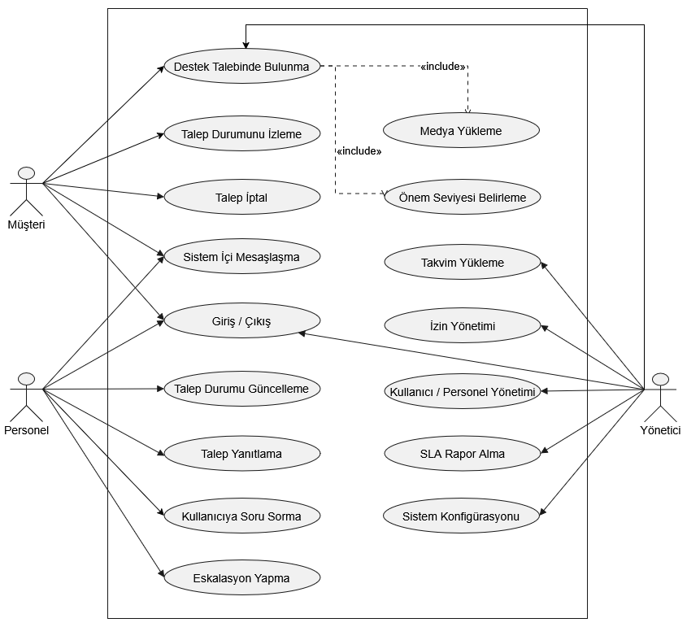

# Destek Talebi Sistemi ve SLA Yönetimi - Yazılım Gereksinimi Belgesi (SRS)

## 1. Amaç
Bu projenin temel amacı; işletmelerin müşteri destek süreçlerini optimize eden, dinamik SLA (Hizmet Seviyesi Anlaşması) hesaplamaları ve akıllı iş yükü dağıtımı sunan yönetilebilir bir sistem geliştirmektir. İşletmeler bu sistemi kendi sunucularına kurarak ve kendi alan adlarını bağlayarak müşterilerine kendi kurumsal siteleri üzerinden hizmet verebileceklerdir. Sistem, müşteri taleplerini personelin aktif mesai saatlerine ve özel çalışma takvimine göre değerlendirerek hedef çözüm sürelerini otomatik belirler. Bu esnek yapı sayesinde işletmeler, mevcut insan kaynaklarını en yüksek verimle kullanabilir.

## 2. Çekirdek Problem ve Proje Kapsamı
Bu projenin çözdüğü çekirdek mühendislik problemi, dinamik takvim verilerine ve personel izin/iş yükü durumlarına duyarlı SLA hesaplama ve eskalasyon algoritmasıdır.
* Sistem; çalışma saatlerini ve tatil günlerini JSON formatında dışarıdan alır. Yöneticiler takvim üzerinde en erken 5 gün sonrası için değişiklik yapabilir.
* Algoritma, talep çözüm sürecindeki spesifik durum akışını (Talep Bekleniyor → Talep Alındı → Talep İnceleniyor → Talep Çözüldü) takip eder.
* Akıllı Eskalasyon: Personelin çözüm için maksimum 3 deneme hakkı vardır. 3 kez reddedilen çözüm sonrası talep otomatik eskalasyona uğrar. Ayrıca, yönetici bir personele izin verdiğinde, personelin elindeki "henüz cevaplanmamış" bir talebin SLA bitiş tarihi bu izin gününe denk geliyorsa, sistem talebi beklemeden otomatik eskalasyon yapar.

## 3. Kapsam Dışı
Aşağıdaki özellikler **kapsam dışı** bırakılmıştır:
* E-posta veya SMS ile bildirim gönderimi.
* Canlı sohbet entegrasyonu (Müşteri ve personel, SLA süresi boyunca sadece talep sayfası üzerinden anlık veya asenkron mesajlaşarak iletişim kurar).
* Gerçek ödeme sistemi veya faturalandırma.
* Biletleri PDF olarak indirme işlemi.

## 4. Varsayımlar ve Bağımlılıklar
* **Sunucu Saat Dilimi:** Sistemin kurulu olduğu sunucunun saat dilimi (Timezone) ayarlarının, işletmenin bulunduğu fiziksel konuma göre doğru yapılandırıldığı varsayılmıştır.
* **Geçerli Veri Formatı:** Yönetici tarafından çalışma programı olarak sisteme yüklenen JSON dosyasının, sistemin beklediği veri şemasına (schema) uygun, eksiksiz ve UTF-8 formatında olduğu varsayılmıştır.
* **Donanım/Ağ Bağımlılığı:** Sistemin sürekli olarak aktif bir MySQL/MariaDB veritabanı sunucusuna bağlı olduğu varsayılmıştır.

## 5. Kısıtlamalar (Constraints)
* **Teknik Kısıtlama (Çatı Bağımsızlığı):** Proje, Laravel veya Symfony gibi harici hazır framework'ler kullanılmadan, PHP, PDO ve Nesne Yönelimli Programlama prensipleriyle (PSR-4 standartlarında) geliştirilmek zorundadır.
* **Mimari Kısıtlama:** Sistem kesinlikle katmanlı mimariyle (Controller, Service, Repository, Model) inşa edilmeli; durum geçişleri State deseniyle, eskalasyon uyarıları ise Observer deseniyle yönetilmelidir.
* **Veritabanı Kısıtlaması:** Veritabanı tasarımı zorunlu olarak en az 3NF (Üçüncü Normal Form) kurallarına uygun şekilde normalize edilmelidir.
* **Dosya Kısıtlaması:** Müşteriler tarafından yüklenecek olan sorun gösterge ekleri güvenlik sebebiyle sadece JPG, PNG ve PDF formatlarıyla kısıtlanmış olup, dosya başına maksimum yükleme boyutu 5 MB olarak belirlenmiştir.

## 6. Tanımlar ve Kısaltmalar
* **SLA (Service Level Agreement):** Hizmet Seviyesi Anlaşması. Müşterinin açtığı bir destek talebinin, işletmenin mesai saatlerine göre maksimum kaç saat/gün içinde çözülmesi gerektiğini belirleyen taahhüt süresi.
* **Eskalasyon:** SLA süresi dolan, izin günü çakışması yaşanan veya personelin 3 çözüm hakkını tükettiği durumlarda, biletin otomatik veya manuel olarak bir üst yetkiliye devredilmesi işlemi.
* **Kanban Panosu:** Personelin üzerine aldığı destek taleplerini durumlarına göre sütunlar halinde gördüğü ve sürükle-bırak yöntemiyle güncellediği asenkron (AJAX) çalışma arayüzü.
* **Ortak Havuz:** Sisteme yeni düşmüş, statüsü "Talep Bekleniyor" olan ve henüz hiçbir destek personeli tarafından kabul edilmemiş biletlerin beklediği genel kuyruk.
* **JSON (JavaScript Object Notation):** Yöneticilerin, işletmeye özel çalışma günlerini, saatlerini ve tatillerini sisteme aktarmak için kullanacakları hafif, metin tabanlı veri değişim formatı.
* **Core PHP:** Herhangi bir dış kütüphane veya web çatısı kullanılmadan yazılan saf PHP kod yapısı.

## 7. Use Case

## 8. Kullanıcı Hikayeleri

**Müşteri Hikayeleri:**
*   **US-01:** Müşteri olarak, sistem üzerinden yeni bir destek talebi açabilmeliyim ki sorunumu yetkililere bildirebileyim.
*   **US-02:** Müşteri olarak, talebime ek dosya ekleyebilmeliyim ki sorunumu daha net anlatabileyim.
*   **US-03:** Müşteri olarak, açtığım taleplerin durumunu (Açık, İşlemde, Çözüldü) listeyebilmeliyim ki sürecin ne aşamada olduğunu bileyim.
*   **US-04:** Müşteri olarak, talebime personel tarafından verilen yanıtları okuyup tekrar cevap yazabilmeliyim.
*   **US-05:** Müşteri olarak, talebimi açarken önem derecesini seçebilmeliyim ki acil durumları sisteme iletebileyim.
*   **US-06:** Müştreri olarak sisteme ad-soyad şifre formatında kayıt olabilmeli ve şifre sıfırlayabilmek için de "gizli soru"ya cevap verebilmeliyim ki e-posta veya sms gerekmeden üyelik oluşturabileyim.
*   **US-07:** Müşteri olarak, henüz "Talep Bekleniyor" aşamasındaki bir talebi iptal edebilmeliyim ki yanlışlıkla açtığım veya kendi kendime çözdüğüm sorunlar personeli meşgul etmesin.

**Personel Hikayeleri:**
*   **US-08:** Personel olarak, üzerime atanan biletleri bir Kanban panosunda görebilmeliyim ki iş takibimi kolay yapabileyim.
*   **US-09:** Personel olarak, talebin durumunu sürükle-bırak yöntemiyle güncelleyebilmeliyim ki işlemlerimi hızlıca kaydedebileyim.
*   **US-10:** Personel olarak, bir talebe metin olarak yanıt yazıp müşteriye iletebilmeliyim.
*   **US-11:** Personel olarak, atanan biletler üzerindeki SLA geri sayımını dakika/saat cinsinden görebilmeliyim ki gecikmeleri önleyebileyim.
*   **US-12:** Personel olarak, SLA süresi yaklaşan biletlerde renkli uyarılar alabilmeliyim ki önceliğimi buna göre belirleyebileyim.

**Yönetici Hikayeleri:**
*   **US-13:** Yönetici olarak, sisteme yeni personel ve kategoriler ekleyebilmeliyim.
*   **US-14:** Yönetici olarak, personel SLA ihlal oranlarını ve ortalama çözüm sürelerini detaylı bir rapor olarak görebilmeliyim.
*   **US-15:** Yönetici olarak, destek kategorilerini ve bu kategorilerin varsayılan SLA kurallarını belirleyebilmeliyim.
*   **US-16:** Yönetici olarak, resmi tatilleri tarih bazlı olarak sisteme girebilmeliyim ki SLA hesaplamaları doğru yapılsın.
*   **US-17:** Yönetici olarak, geciken biletlerin) hangi üst personele otomatik devredileceğini seçebilmeliyim.
*   **US-18:** Yönetici olarak, işletmemin çalışma günlerini) ve mesai saatlerini sisteme tanımlayabilmeliyim ki SLA hesaplamaları tamamen işletmeme özel yapılabilsin.

## 9. İşlevsel Gereksinimler (Functional Requirements - FR)

*   **FR-01:** Sistem, müşteri girişi yapıldığında kategori, öncelik, başlık ve mesaj alanlarından oluşan bir form sunmalıdır. (Bağlantılı Hikayeler: US-01, US-05)
*   **FR-02:** Sistem, bilet oluşturma esnasında JPG/PNG/PDF formatlarında, tür ve boyut kontrolü yapılarak ek dosya yüklenmesine izin vermelidir. (US-02)
*   **FR-03:** Sistem, biletin içeriğini (metnini) analiz ederek anahtar kelime eşleşmesi ile akıllı/gölge öncelik belirleyebilmelidir.
*   **FR-04:** Sistem, açılan yeni bileti, havuzdaki mevcut aktif iş yükü (açık bilet sayısı) en az olan personele otomatik olarak atamalıdır.
*   **FR-05 (Çekirdek Algoritma):** Sistem; biletin açıldığı anı, sisteme girilen resmi tatil günlerini ve mesai saatlerini hesaplayarak kesin bir SLA bitiş tarihi (Deadline) oluşturmalıdır.
*   **FR-06:** Sistem, durum geçişlerini State deseni ile kısıtlamalıdır. Kapatılmış bir bilet yeniden "İşlemde" durumuna alınamaz ve sadece "Talep Bekleniyor" statüsündeki biletler müşteri tarafından "İptal Edildi" statüsüne çekilebilir. (US-07, US-08)
*   **FR-07:** Sistem, SLA süresinin %80'i dolduğunda bileti arayüzde sarı uyarı moduna, %100'ü dolduğunda ise kırmızı ihlal moduna sokmalıdır. (US-09, US-10)
*   **FR-08:** Sistem, SLA süresi tamamen dolduğunda bileti otomatik olarak eskalasyon yöneticisine (bir üst yetkiliye) devretmeli ve veritabanına eskalasyon kaydı atmalıdır.
*   **FR-09:** Sistem, personelin biletleri yönetmesi için AJAX tabanlı (sayfa yenilemeden çalışan) bir Kanban panosu sağlamalıdır. (US-06)
*   **FR-10:** Sistem, yöneticilerin SLA kurallarını (X kategorisi için Y saat SLA kuralı) CRUD mantığı ile yönetmesine imkan tanımalıdır. (US-13)
*   **FR-11:** Sistem, yöneticilerin sadece tarih seçerek resmi tatilleri ekleyebileceği bir takvim arayüzü sunmalıdır. (US-14)
*   **FR-12:** Sistem, bilet çözüm işlemlerini kayıt altına almalı ve her personel için "SLA'ya uyum oranı" ve "Ortalama çözüm süresi" değerlerini hesaplayıp raporlamalıdır. (US-12)
*   **FR-13:** Sistem, SLA hesaplamasında (FR-05) kod içine sabitlenmiş (hard-coded) saatler yerine, yöneticinin sistem ayarlarından girdiği dinamik mesai günlerini ve saatlerini veritabanından çekerek baz almalıdır. (US-16)
*   **FR-14:** Sistem; bir bilet eskalasyona uğradığında yeni atanan personelin talebi inceleyebilmesi için veya SLA süresinin dolmasına çok az kala müşteri tarafından yeni bir yanıt/itiraz geldiğinde, mevcut SLA bitiş tarihine yöneticinin belirlediği standart bir ek süre otomatik olarak ilave etmelidir.

## 10. İşlevsel Olmayan Gereksinimler (Non-Functional Requirements - NFR)

*   **NFR-01:** SLA hesaplama algoritması, 5 yıllık tatil verisi ve on binlerce bilet kaydı veritabanında bulunsa dahi, yeni bir bilet açıldığında süre hesabını en fazla **500 milisaniye (0.5 saniye)** içerisinde tamamlamalıdır.
*   **NFR-02:** Personel Kanban panosu, ilgili personelin üzerinde 100 aktif bilet bulunduğunda bile sayfayı **1 saniyenin altında** render etmeli ve AJAX sürükle-bırak gecikmesi **200 ms altında** gerçekleşmelidir.
*   **NFR-03:** Sisteme yüklenen ek dosyalar genel URL ile indirilememeli, "storage" dizininde korunmalı ve sadece biletin yetkili kullanıcısına **1 saniye içerisinde** doğrulanarak gösterilmelidir.
*   **NFR-04:** İki personelin havuzdaki aynı bileti aynı anda üzerine almak istemesi durumunda, sistem ilk işlemi veritabanında satır kilidi (`SELECT ... FOR UPDATE`) ile bağlamalı ve ikinci personelin isteğini maksimum **100 ms içinde** reddederek hata mesajı göstermelidir.
*   **NFR-05:** Sistem arayüzü (özellikle Kanban panosu ve formlar), 375 px (mobil) genişlik ile 1920 px (masaüstü) genişlik arasındaki tüm ekranlarda, **%100 oranında yatay kaydırma çubuğu çıkmayacak şekilde** fonksiyonelliğini korumalıdır.
