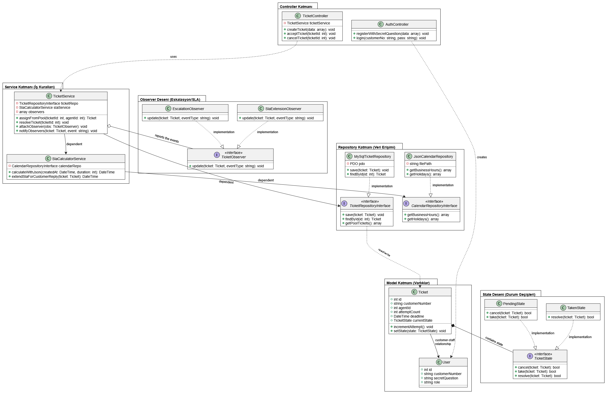
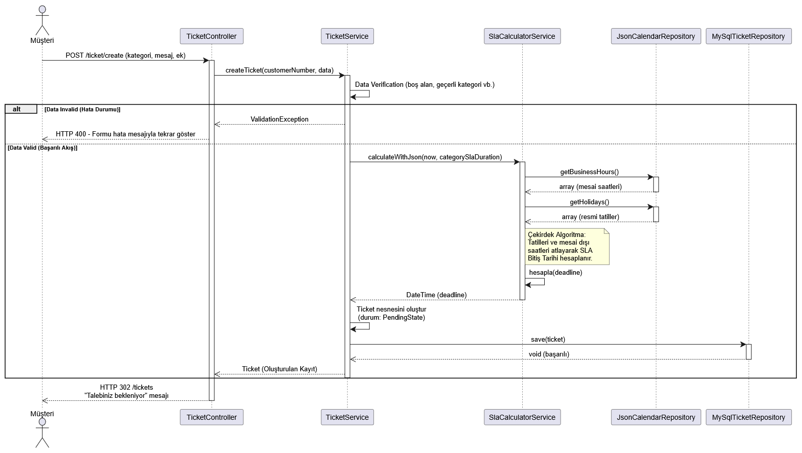
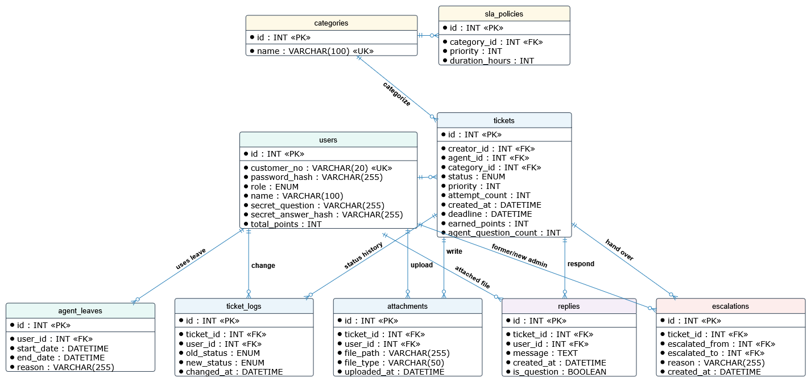
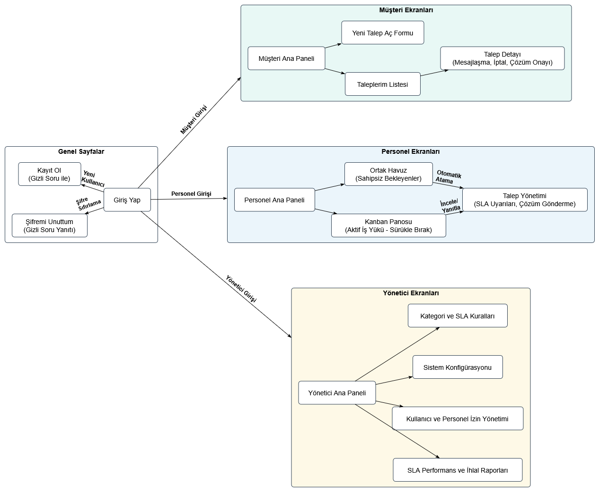
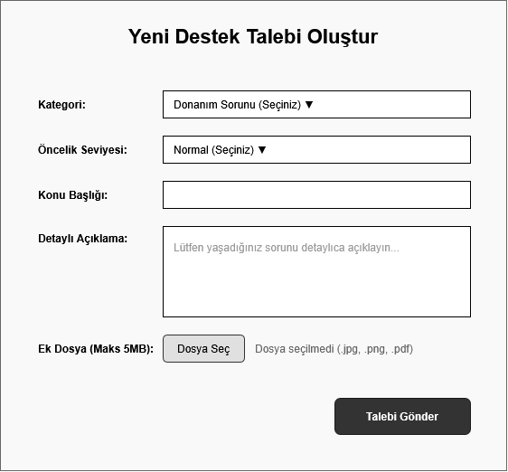
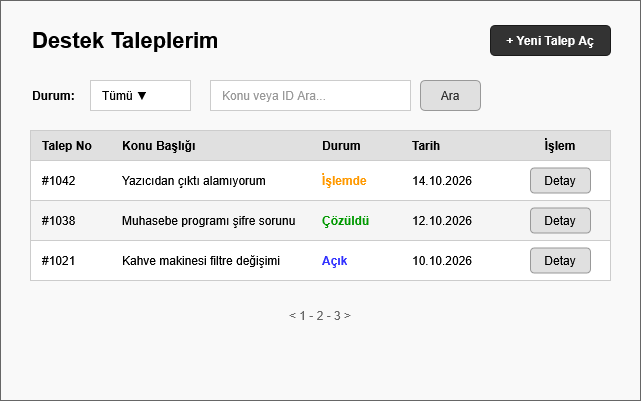
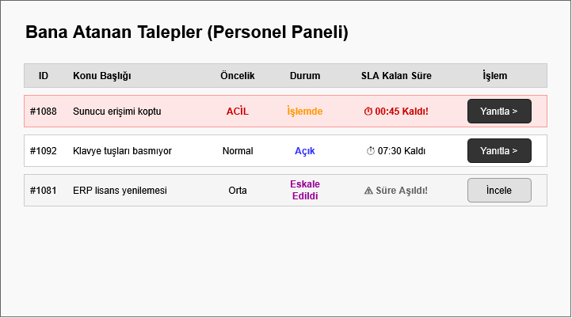
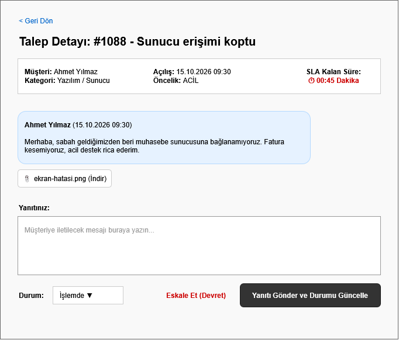
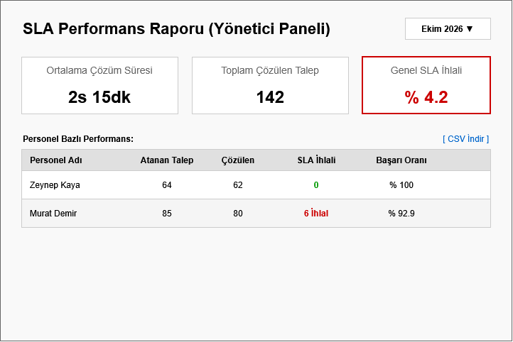

# 1. Mimari

Projemiz, herhangi bir harici framework (Laravel, Symfony vb.) kullanılmadan, tamamen modern PHP standartlarına (PSR-4, PSR-12) uygun Core PHP ile geliştirilmektedir. Sistem; JSON tabanlı dinamik takvim işleme, özel Müşteri Numarası ile e-postasız giriş, ortak havuz yönetimi ve akıllı eskalasyon gibi karmaşık iş kurallarını barındırdığı için, bu yükü hafifletmek adına katı bir MVC (Model-View-Controller) türevi mimari ile tasarlanmıştır.

## 1.1. Katman Şeması

| Katman | Görevi | Asla Yapmaz | Destek Talebi Projesi Örneği |
| :--- | :--- | :--- | :--- |
| **Router** | URL adresine göre hangi controller metodunun çalışacağını seçer. | İş kuralı veya algoritma içermez. | `POST /ticket/accept` → `TicketController::acceptTicket` |
| **Controller** | İstekten veriyi alır, ilgili servisi çağırır ve görünümü (View) veya JSON (AJAX için) döndürür. | Veritabanı sorgusu yazmaz, JSON takvimini ayrıştırmaz. | `TicketController`, `AuthController` |
| **Service** | Projenin iş kurallarını (3 hak kuralı, 3 gün oto-kapanış) ve çekirdek SLA algoritmasını barındırır. | `$_POST` okumaz, HTML üretmez veya ekrana çıktı basmaz. | `SlaCalculatorService::calculateWithJson`, `TicketService::assignFromPool` |
| **Repository** | Veritabanı (PDO) veya dosya sistemi (JSON) okuma/yazma işlemlerini soyutlar. | İş kuralı, yetki veya eskalasyon kontrolü içermez. | `TicketRepositoryInterface`, `JsonCalendarRepository` |
| **Model** | Veritabanındaki bir kaydı temsil eden, veriyi taşıyan sade sınıflardır. | Veritabanı bağlantısı açmaz, SQL çalıştırmaz. | `Ticket`, `User`, `CalendarConfig` |
| **View** | Kullanıcıya HTML arayüzünü (Kanban panosu vb.) gösterir ve XSS önlemi alır. | Veritabanından doğrudan veri çekmez, iş hesabı yapmaz. | `views/kanban/board.php`, `views/auth/login.php` |

## 2. Sınıf Diyagramı

## 3. Sıralama Diyagramı

## 4. ER Diyagramı Ve Normalizasyon

### 4.1 3NF Normalizasyon Gerekçesi

Veritabanı tasarımımız, veri tekrarını önlemek ve tutarlılığı korumak adına yeni eklenen ek dosyalar (`attachments`), durum geçmişi (`ticket_logs`) ve puan verileri de dahil edilerek 3NF standartlarına uygun tasarlanmıştır:

* **1NF (Birinci Normal Form):** Hiçbir tabloda liste halinde veya virgülle ayrılmış veri bulunmaz; tüm sütunlar atomiktir. Örneğin, bir biletin birden fazla ek dosyası veya durum değişimi olabileceği için bu veriler `tickets` tablosunda virgülle tutulmamış, tamamen ayrı `attachments` ve `ticket_logs` tablolarına taşınarak 1:N ilişkisi kurulmuştur.
* **2NF (İkinci Normal Form):** Tablolardaki tüm özellikler, kompozit anahtarlara değil doğrudan tekil birincil anahtara tam bağımlıdır. Kısmi bağımlılık ihtimali, her tabloya özel bağımsız ve otomatik artan tekil bir `id` atanarak baştan engellenmiştir.
* **3NF (Üçüncü Normal Form):** Tablolarda anahtar olmayan sütunların birbirine geçişli bağımlılığı yoktur. Örneğin, `tickets` tablosunda kategorinin adı veya SLA saat sınırı tutulmaz; sadece `category_id` tutulur ve bu kurallar `categories` ile `sla_policies` tablolarından referansla çekilir. Benzer şekilde, personelin kazandığı toplam puan bilette değil `users` tablosunda kümülatif tutulur. Bu sayede örneğin bir kategori ismi değiştiğinde binlerce bilet kaydının güncellenmesine gerek kalmaz.

## 5. Tasarım Desenleri

Projede mimari zorunluluk olan Repository desenine ek olarak, dinamik bilet akışını ve eskalasyon/izin yönetimini kontrol altında tutmak için iki temel tasarım deseni uygulanmıştır.

## 5.1 State Deseni
* **Problem:** Sistemdeki taleplerin Talep Bekleniyor, Talep Alındı, Talep İnceleniyor ve Talep Çözüldü gibi katı bir akış izlemesi gerekmektedir. Bir müşterinin talebi sadece "Bekleniyor" statüsündeyken iptal edilebilmeli, ilgili personel ise 3. çözüm reddinden sonra talebi tekrar "Alındı" statüsüne geçirememelidir.
* **Desen:** State deseni; biletin güncel statüsünü temsil eden durum sınıfları (PendingState, TakenState, ResolvedState vb.) ile uygulanır. Her sınıf kendi içindeki "iptal edilebilir mi?", "tekrar alınabilir mi?" kurallarını barındırır.
* **Alternatif:** Desensiz çözüm, TicketService veya Controller içinde durumu kontrol eden devasa ve okunabilirliği çok az olan bir if/elseif/switch yığını kullanmaktı.
* **Neden Seçildi:** Kurallar karmaşıklaştığı için , her durumun geçiş mantığını kendi sınıfına hapsetmek koddaki hata ihtimalini minimize eder ve mimariyi temiz tutar.

## 5.2 Observer Deseni
* **Problem:** Sistemde bir olayın başka olayları tetiklemesi gereken çoklu durumlar vardır: Yöneticinin bir personele izin girmesi o an SLA'sı dolmak üzere olan biletleri anında eskalasyona sokmalı, 3 iş günü dolduğunda bilet otomatik kapanmalı veya müşteri itiraz ettiğinde SLA süresi örn: +12 saat uzamalıdır ayrıca müşteri yanıt verdiğinde SLA uzar, ancak personel soru sorduğunda SLA algoritması tetiklenmemelidir.
* **Desen:** Observer deseni; bir olay gerçekleştiğinde sistemi haberdar eden yayıncılar ve bu olayları dinleyip tepki veren EscalationObserver, SlaExtensionObserver gibi gözlemci sınıflarla uygulanır.
* **Alternatif:** Desensiz çözüm, personelin izin ekleme fonksiyonunun içine gidip SLA hesaplama ve eskalasyon devretme fonksiyonlarını (hard-coded) doğrudan çağırmaktı.
* **Neden Seçildi:** Gözlemci deseni sayesinde izin yönetim modülü ile bilet yönetim modülü birbirinden tamamen bağımsız çalışır. Bu sayede modüller arası tight coupling engellenir.

## 6. Arayüz ve Sayfa Haritası

## 7. Ekran Taslakları

## 7.1 Müşteri Talep Formu

## 7.2 Müşteri Taleplerim

## 7.3 Personel Talepler

## 7.4 Personel Detay

## 7.5 Yönetici SLA Rapor

## 8. Risk Listesi

Geliştirme sürecinde projenin iş kurallarını (JSON takvim, SLA, havuz yönetimi) ve zaman planlamasını tehdit eden riskler aşağıda listelenmiş ve derecelendirilmiştir.

| Risk | Olasılık | Etki | Önlem |
| :--- | :--- | :--- | :--- |
| **JSON takvim işleme algoritmalarının SLA'i yanlış hesaplaması (Çekirdek Problem)** | Orta | Yüksek | Yüklenen JSON formatının kesin yapısal doğrulamadan geçirilmesi ve `SlaCalculatorService` için kapsamlı PHPUnit testleri yazılması. |
| **Aynı anda birden fazla personelin Ortak Havuzdaki aynı bileti alması (Race Condition)** | Düşük | Yüksek | Veritabanı okuma-yazma anında kilitleme mekanizması kullanılması. |
| **Oto-eskalasyon döngülerinin sunucuyu kilitlemesi veya sonsuz döngüye girmesi** | Orta | Yüksek | Yöneticinin personele izin girdiği anda çalışan eskalasyon tetikleyicisinin, işlem öncesi veritabanı kilit mekanizmaları ile korumaya alınması. |
| **Zararlı dosya yükleme girişimleri** | Orta | Yüksek | Müşteri ek dosyaları için sadece JPG ve PNG izin verilmesi, sıkı MIME-type doğrulaması yapılması ve dosyaların doğrudan erişime kapalı `storage` klasöründe tutulması. |
| **Kanban panosunda aşırı veri yüklenmesinden kaynaklı tarayıcı donması** | Yüksek | Orta | Kanban sütunlarındaki aktif biletlere limitasyon getirilmesi ve kapalı biletlerin panodan kaldırılarak ayrı bir ekrana taşınması. |
| **Puan sisteminin istismarı** | Orta | Yüksek | Personelin hızlı puan kazanmak için eksik çözüm sunmasını engellemek adına, kazanılan puanların hesaba "Müşteri Onayı" alındıktan sonra geçmesinin sağlanması. |
| **Sunucu ve Veritabanı Saat Dilimi Uyuşmazlığı** | Yüksek | Yüksek | SLA bitiş sürelerinin yanlış hesaplanmaması için tüm `DateTime` objelerinde ve veritabanı bağlantısında sabit bir saat dilimi standardı belirlenmesi. |
| **Ekip içi geliştirme esnasında çakışan kodlar** | Yüksek | Düşük | Özelliklerin dosya bazında modüllere ayrılarak dağıtılması ve branch ve Pull Request sistemiyle kontrollü kod birleştirme uygulanması. |

## 9. Plan ve Backlog

Projenin görev dağılımı, zaman yönetimi ve iş takibi GitHub Projects üzerinde oluşturulan Scrum/Kanban tabanlı backlog panosu üzerinden yürütülmektedir. SRS belgesindeki tüm İşlevsel Gereksinimler ve kullanıcı hikayeleri birer GitHub Issue olarak açılmış ve ilgili kilometre taşlarına bağlanmıştır.

* **Proje Backlog Panosu:** [GitHub Projects Panosuna Git](https://github.com/users/BerkayBaskara/projects/4)

### 9.1. Kilometre Taşları (Milestones)

Projenin geliştirme süreci, dersin gereksinimlerine uygun olarak 3 ana kilometre taşına (Milestone) bölünmüştür:

* **Kilometre Taşı 1: Sunum 1 (Tasarım ve Mimari)**
  * **Hedef:** Proje gereksinimlerinin çıkarılması, katmanlı mimarinin kurulması, UML ve ER diyagramlarının tamamlanması.
  * **Durum:** Tamamlandı.
* **Kilometre Taşı 2: Sunum 2 (Aşama 2 - Veritabanısız Geliştirme)**
  * **Hedef:** Projenin veritabanı olmadan, tamamen JSON dosyaları (Repository katmanı) üzerinde çalışan sürümünün tamamlanması. Çekirdek problem olan SLA algoritmasının ve Kanban arayüzünün kodlanması, ilgili `aşama-2` etiketli Issue'ların kapatılması.
* **Kilometre Taşı 3: Sunum 3 (Aşama 3 - Veritabanı ve Final)**
  * **Hedef:** Sistemin JSON'dan MySQL/MariaDB veritabanına geçirilmesi (Mimari yapı sayesinde sadece Repository sınıfları değiştirilecektir). Eskalasyon loglarının, yetki kontrollerinin, PDO transaction/satır kilidi güvenliklerinin uygulanması ve PHPUnit testlerinin tamamlanarak projenin canlıya hazır hale getirilmesi.

### 9.2. İş Takip Yöntemi
Panomuzda `Backlog`, `Bu hafta`, `Devam ediyor` ve `Bitti` sütunları bulunmaktadır. Her bir geliştirme görevi (`aşama-2`, `aşama-3`, `çekirdek`, `test` etiketleriyle) ekip üyelerine atanmış olup, *Branch* ve *Pull Request* mantığıyla çakışmalar önlenerek ana (`main`) dala aktarılacaktır.