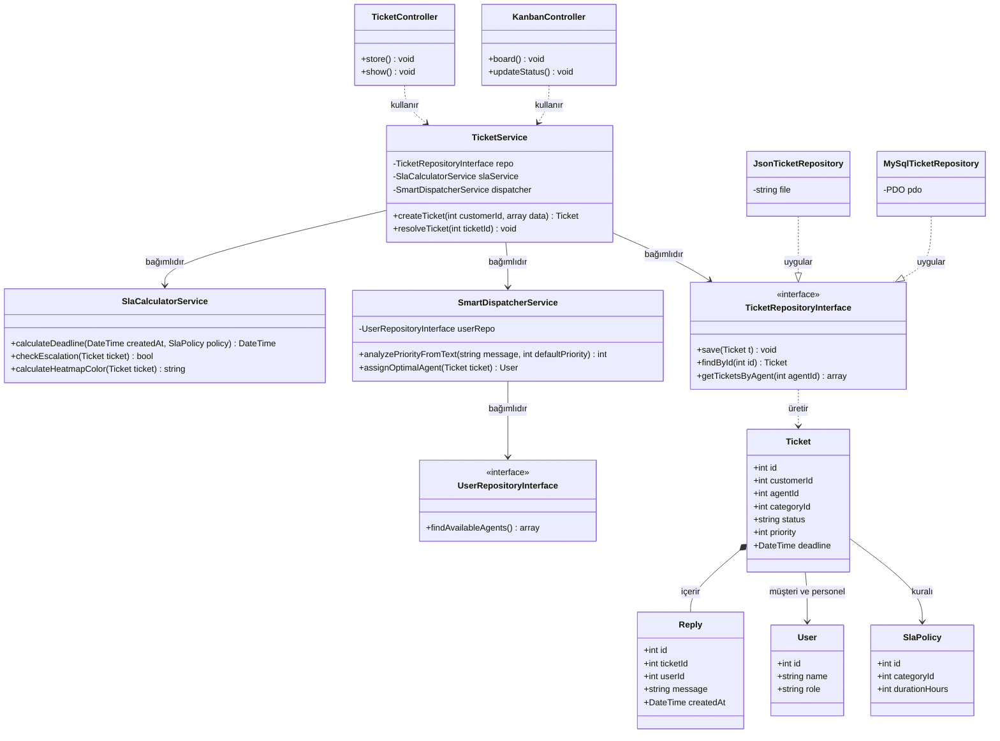
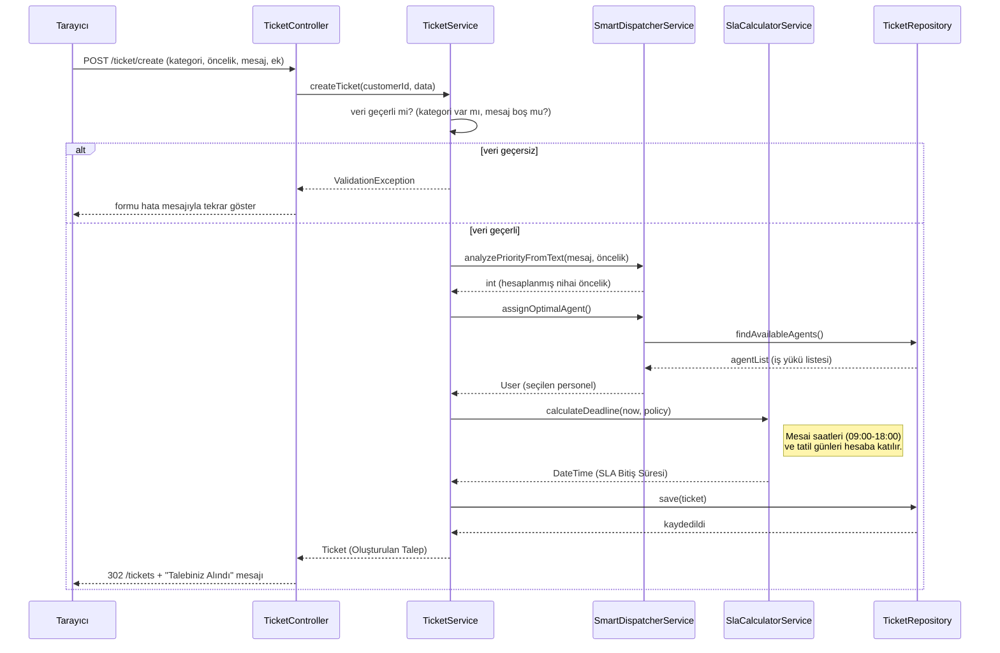
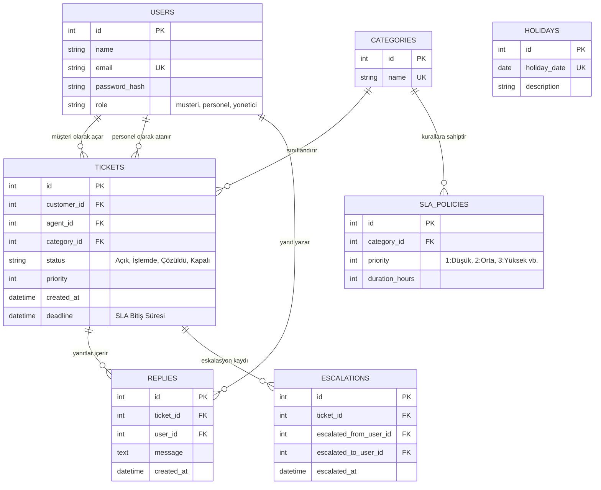
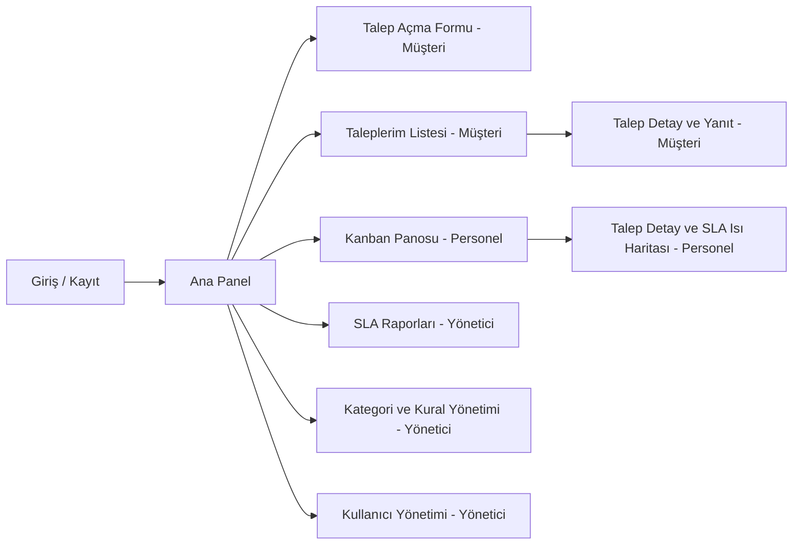

# 1. Mimari

Projemiz, modern PHP standartlarına (PSR-4, PSR-12) uygun olarak Controller, Service, Repository ve Model katmanlarından oluşan MVC (Model-View-Controller) türevi katmanlı bir mimari üzerine inşa edilmiştir. Yenilikçi özelliklerimiz (Kanban, Akıllı Dağıtım, SLA Isı Haritası) iş mantığını yormamak adına özel servis sınıflarına (Service) ayrılmıştır.

## 1.1. Katman Şeması

| Katman | Görevi | Asla Yapmaz | Destek Talebi Projesi Örneği |
| :--- | :--- | :--- | :--- |
| **Router** | URL adresine göre hangi controller metodunun çalışacağını seçer. | İş kuralı veya algoritma içermez. | `POST /ticket/create` → `TicketController::store` |
| **Controller** | İstekten (`$_POST`/`$_GET`) veriyi alır, ilgili servisi çağırır ve uygun görünümü (View) döndürür. | Veritabanı (SQL) sorgusu yazmaz, SLA hesabı yapmaz. | `TicketController`, `KanbanController` |
| **Service** | Projenin iş kurallarını ve çekirdek algoritmalarını barındırır. | `$_POST` okumaz, HTML üretmez veya doğrudan ekrana basmaz. | `SlaCalculatorService::calculateTime`, `SmartDispatcherService::assignTicket` |
| **Repository** | Veritabanı (veya JSON) okuma/yazma işlemlerini soyutlar. | İş kuralı veya yetki kontrolü içermez. | `TicketRepositoryInterface`, `JsonTicketRepository` |
| **Model** | Veritabanındaki bir kaydı temsil eden, veriyi taşıyan sade (DTO benzeri) sınıftır. | Veritabanı bağlantısı açmaz, SQL çalıştırmaz. | `Ticket`, `User`, `SlaPolicy` |
| **View** | Kullanıcıya HTML arayüzünü gösterir ve XSS önlemi için çıktıyı kaçışlar. | Veritabanından veri çekmez, karmaşık hesaplama yapmaz. | `views/kanban/board.php`, `views/ticket/form.php` |

## 1.2. Klasör Yapısı

Sistemdeki her bir dosya, projenin tek giriş noktası olan `public/index.php` üzerinden yönlendirilir. Dışarıdan yalnızca `public/` dizinine erişilebilir.

```text
destek-talebi-sistemi/
├── public/            # index.php (tek giriş noktası), css, js (Kanban AJAX), görseller
├── src/
│   ├── Controller/    # HTTP isteklerini karşılayan sınıflar (TicketController, AuthController)
│   ├── Service/       # SLA hesabı, kelime bazlı önceliklendirme ve akıllı atama algoritmaları
│   ├── Repository/    # Veri erişim arayüzleri ve JSON/MySQL implementasyonları
│   └── Model/         # Varlık sınıfları (User, Ticket, Category, Escalation)
├── views/             # Şablon dosyaları (Kanban panosu, ısı haritası görünümleri)
├── database/          # MySQL migration ve örnek veri (seed) betikleri (Aşama 3 için)
├── tests/             # Çekirdek SLA hesaplamaları için PHPUnit testleri
├── docs/              # srs.md, tasarim.md, ai-gunlugu.md ve telif/taslak görselleri
├── storage/           # Müşterilerin yüklediği ek dosyalar ve Aşama 2 JSON verileri
├── composer.json      # PSR-4 otomatik yükleme (autoload) ve bağımlılık (PHPUnit vb.) ayarları
└── README.md          # Kurulum ve çalıştırma talimatları
```

## 2. Sınıf Diyagramı

Sınıf diyagramımız, hocanın gereksinimlerinde belirttiği gibi en az 12 sınıftan oluşmaktadır[cite: 5]. Yenilikçi özelliklerimiz olan kelime bazlı önceliklendirme ve akıllı iş yükü ataması `SmartDispatcherService` içinde, çekirdek problemimiz olan mesai saatlerine duyarlı hesaplamalar ise `SlaCalculatorService` içinde konumlandırılmıştır[cite: 3]. Controller katmanı kesinlikle doğrudan Repository katmanına erişmez; tüm işlemler Service katmanı üzerinden geçer[cite: 5].



## 3. Sıralama Diyagramı

Sıralama diyagramı, projenin çekirdek problemi olan "yeni bir destek talebinin açılması, kelime bazlı önceliklendirilmesi, SLA süresinin hesaplanması ve uygun personele atanması" akışını göstermektedir. Mimari katman kurallarına uygun olarak Tarayıcı, Controller, Service ve Repository arasındaki iletişim resmedilmiştir. Hata durumu (geçersiz veri) `alt` bloğu ile ayrılmıştır[cite: 5].



## 4. ER Diyagramı ve Normalizasyon

Aşağıdaki ER diyagramı, Aşama 3'te MySQL/MariaDB üzerinde kurulacak olan veritabanımızın yapısını göstermektedir. Sistemdeki tablolar, destek talebi ve SLA hesaplama gereksinimlerini karşılayacak şekilde tasarlanmıştır[cite: 3].



## 5. Tasarım Desenleri

Projede mimari zorunluluk olan **Repository** desenine ek olarak, destek talebi akışını ve SLA uyarı sistemini yönetmek için iki farklı tasarım deseni daha kullanılmıştır. Bu desenler ve seçim gerekçeleri aşağıdadır[cite: 5]:

### 5.1. State Deseni (Durum Yönetimi)
-   **Problem:** Destek taleplerinin belirli bir durum akışı (Açık → İşlemde → Çözüldü → Kapalı) izlemesi ve geçersiz durum geçişlerinin (Örn: Kapalı bir biletin İşlemde'ye alınması) engellenmesi gerekiyordu.
-   **Desen:** State deseni; `TicketState` arayüzü ile onu uygulayan `OpenState`, `InProgressState`, `ResolvedState` ve `ClosedState` sınıfları üzerinden uygulanmaktadır.
-   **Alternatif:** Desensiz çözüm, Controller veya Service içinde devasa `if/elseif` veya `switch/case` blokları yazarak durum kontrolü yapmaktı.
-   **Neden:** State deseni sayesinde her durum kendi kurallarını ve geçiş izinlerini yönetir, koda dokunmadan yeni bir durum eklemek kolaylaşır ve karmaşık `if` yığınlarının önüne geçilir.

### 5.2. Observer Deseni (SLA Eskalasyon ve Uyarı)
-   **Problem:** SLA süresinin dolması veya %80'e ulaşması gibi durumlarda, sistemin uyarı üretmesi ve otomatik olarak bir üst yetkiliye eskalasyon işlemini tetiklemesi gerekiyordu.
-   **Desen:** Observer deseni; olayları takip eden `TicketSubject` sınıfı ile tetiklendiğinde çalışan `SlaWarningObserver` ve `EscalationObserver` sınıfları aracılığıyla uygulanmaktadır.
-   **Alternatif:** Desensiz çözüm, SLA zamanını kontrol eden döngünün veya servisin içine eskalasyon kodlarını ve uyarı mesajlarını doğrudan (hard-coded) yazmaktı.
-   **Neden:** Observer deseni sayesinde olayı tespit eden kısım (SLA kontrolcüsü) ile olaya tepki veren kısım (eskalasyon/uyarı) birbirinden ayrılır, böylece sınıfların bağımlılıkları azalır ve esneklik artar.

## 6. Arayüz ve Sayfa Haritası

### 6.1. Sayfa Haritası

Sistemimizdeki sayfalar ve roller arası geçişler aşağıdaki haritada gösterilmiştir. Sistemde üç ana rol bulunmaktadır: Müşteri, Personel ve Yönetici.



## 7. Risk Listesi

Projenin zamanında ve eksiksiz tamamlanmasını engelleyebilecek potansiyel riskler, olasılık/etki dereceleri ve bunlara karşı alınacak önlemler aşağıda listelenmiştir. Çekirdek problemimiz olan SLA ve atama algoritmalarına özel önem verilmiştir[cite: 5].

| Risk | Olasılık | Etki | Önlem |
| :--- | :--- | :--- | :--- |
| **SLA tatil/mesai saati hesaplamalarının yanlış çıkması (Çekirdek Problem)** | Orta | Yüksek | `SlaCalculatorService` için özellikle hafta sonu, resmi tatil ve mesai bitimine denk gelen senaryoları kapsayan kapsamlı PHPUnit testleri yazılacak. |
| **Akıllı atama algoritmasının yükü yanlış dağıtması (Çekirdek Problem)** | Orta | Yüksek | Dağıtım servisine bir üst limit (threshold) eklenecek; uygun personel bulunamazsa biletler havuzda (genel kuyruk) bekletilecek. |
| **Eşzamanlılık (Race Condition) hatası** | Düşük | Orta | İki personelin aynı bileti aynı anda üzerine almasını veya kapatmasını önlemek için veritabanında *transaction* ve *satır kilidi* (`SELECT ... FOR UPDATE`) kullanılacak. |
| **Yenilikçi arayüzlerin (Kanban vb.) kapsamı şişirmesi (Scope Creep)** | Yüksek | Orta | Öncelikle temel CRUD ve arka plan SLA algoritması bitirilecek. Kanban ve AJAX özellikleri ikinci öncelik olarak ele alınacak; backlog'a sadık kalınacak. |
| **Yapay zekânın (AI) katman kurallarını bozması** | Yüksek | Yüksek | AI'a verilen her istemin (prompt) başına 1. Bölüm'deki mimari katman tablosu kural olarak verilecek. Kod depoya (commit) eklenmeden önce mutlaka ekipçe okunacak. |
| **Aynı dosyada çakışan değişiklikler (Git Conflict)** | Yüksek | Düşük | Kesinlikle dal (branch) ve pull request (PR) mantığıyla çalışılacak. Üyelerin görevleri dosya bazında ayrıştırılarak çakışma ihtimali en aza indirilecek. |